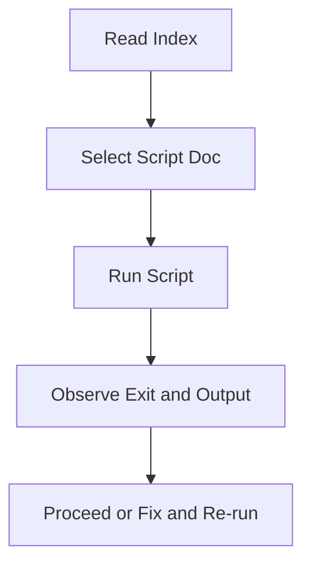

# commands_index.md

Source Folder: My_Docs/commands
Last Synced: 2026-04-14 19:46:42

## Vision
Single source of truth for operational commands in prelaunch stage.

## Why This File Exists
- Centralize command discovery and run order for release checks.
- Keep script-level knowledge explicit and reviewable.

## Core Logic
- Index operational scripts and expected usage sequence.
- Provide one navigation point for deterministic execution workflows.

## Control Flow Graph and Map

## Control Flow Narrative
- Reader locates the exact script for the intended validation step.
- Script documentation then guides deterministic execution and result interpretation.

## Class and Function Catalog
- N/A for index document.

## Scripts
- fast_regression.ps1.md
- backend_conformance_check.ps1.md

## Critical Invariants
- Script list must stay aligned with actual command files.
- Documentation order should reflect recommended execution order.

## Why
- Keep command execution deterministic and easy to audit.
