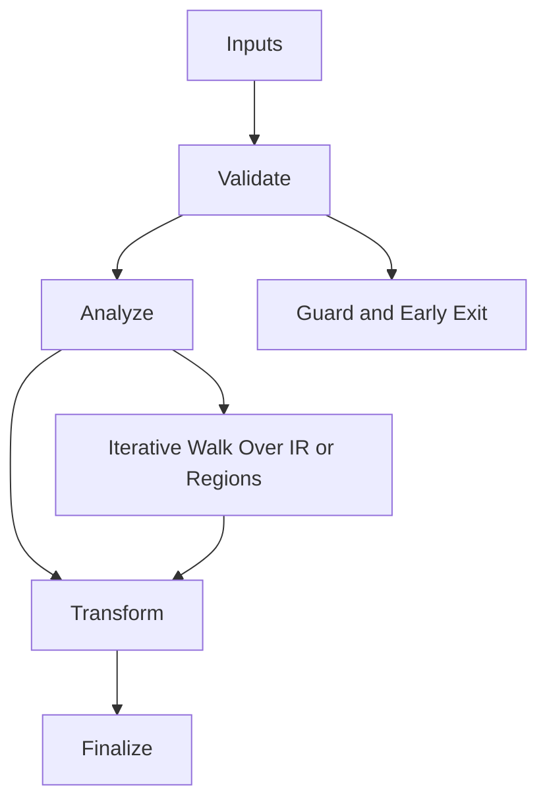

# Debug_Metadata.hpp

Source Header: include/dgtl/core/Debug_Metadata.hpp
Last Synced: 2026-04-14 19:46:40

## Vision
This component exists to make the compiler/runtime pipeline explicit, safe, and predictable under high-performance constraints.

## Why This File Exists
- Provide foundational contracts for memory, validation, target behavior, and shared compiler state.
- Keep responsibilities localized so surrounding passes and backends can compose without hidden coupling.
- Preserve correctness with explicit guardrails before optimization gains.
- Sentinel-style integrity checks are intentionally present to detect corruption before commit stages.

## Core Logic
- Inputs are validated early and non-actionable states return fast.
- Main logic operates on typed IR structures and explicit state transitions.
- Traversal is iterative to keep performance linear over stream and region size.
- The design favors deterministic transformations and bounded side effects.
- Defensive error paths are explicit to prevent silent corruption propagation.

## Control Flow Graph and Map

## Control Flow Narrative
- Entry points validate stream and state before any mutation or expensive work.
- Processing is mainly loop-driven to walk nodes, regions, or dependency structures.

## Include Dependencies
- #include <vector>
- #include <cstdint>
- #include 
- #include <cmath>
- #include <atomic>
- #include <cstring>
- #include <algorithm>
- #include "dgtl/ir/base/Global_IR.hpp"
- #include "dgtl/core/Arena.hpp"

## Class and Struct Catalog
### Classes
- class DGTLDebugStore {
### Structs
- struct alignas(8) SourceLoc {
- struct ScopeEntry {

## Enum Catalog
- none detected

## Function Catalog
- explicit DGTLDebugStore(core::DGTL_Arena& arena, size_t max_nodes) {
- void record_loc(size_t node_idx, uint32_t line, uint16_t col, uint16_t file_id, bool is_shadow = false) noexcept {
- [[nodiscard]] SourceLoc get_loc(size_t node_idx, bool prefer_shadow = false) const noexcept {
- void commit_shadow_slice(size_t start, size_t end) noexcept {
- void rollback_shadow_slice(size_t start, size_t end) noexcept {
- static size_t write_sleb128(uint8_t* dest, int64_t value) noexcept {
- std::vector<uint8_t> emit_dwarf_line_table() const {

## Design Decisions and Whys
- Explicit typing across IR nodes and flags reduces hidden semantic drift.
- Guard checks prevent invalid states from propagating into emitters and runtime paths.
- Layered modules allow policy evolution in pass and pipeline without backend rewrites.

## Critical Invariants
- Public operations should preserve deterministic behavior for equivalent inputs.

## Practical Reading Order
- Start with type and enum declarations.
- Follow entry functions for control-flow intent.
- Then inspect helper methods for safety and transformation details.
