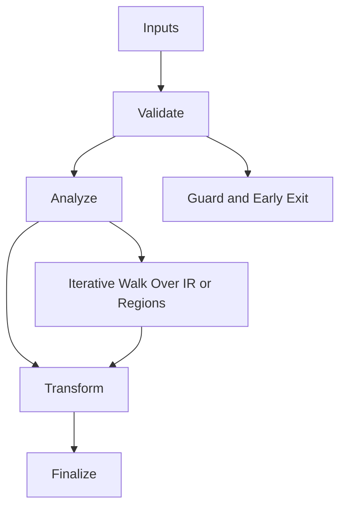

# Symbol_Table.hpp

Source Header: include/dgtl/core/Symbol_Table.hpp
Last Synced: 2026-04-14 19:46:40

## Vision
This component exists to make the compiler/runtime pipeline explicit, safe, and predictable under high-performance constraints.

## Why This File Exists
- Provide foundational contracts for memory, validation, target behavior, and shared compiler state.
- Keep responsibilities localized so surrounding passes and backends can compose without hidden coupling.
- Preserve correctness with explicit guardrails before optimization gains.
- This file captures a focused subsystem contract so complexity does not leak across module boundaries.

## Core Logic
- Inputs are validated early and non-actionable states return fast.
- Main logic operates on typed IR structures and explicit state transitions.
- Traversal is iterative to keep performance linear over stream and region size.
- The design favors deterministic transformations and bounded side effects.

## Control Flow Graph and Map

## Control Flow Narrative
- Entry points validate stream and state before any mutation or expensive work.
- Processing is mainly loop-driven to walk nodes, regions, or dependency structures.

## Include Dependencies
- #include <cstdint>
- #include <string_view>
- #include <vector>
- #include <optional>
- #include <unordered_map>
- #include 
- #include <memory>
- #include "dgtl/ir/base/IR_Types.hpp"
- #include "dgtl/core/Arena.hpp"

## Class and Struct Catalog
### Classes
- class alignas(64) SymbolTable {
### Structs
- struct alignas(16) SymbolEntry {

## Enum Catalog
- none detected

## Function Catalog
- void push_scope() {
- void pop_scope() {
- bool define(std::string_view name, uint32_t slot_id, dgtl::ir::OpCode type = dgtl::ir::OpCode::NOP) {
- [[nodiscard]] std::optional<SymbolEntry> resolve(std::string_view name) const noexcept {
- [[nodiscard]] SymbolEntry* get(std::string_view name) noexcept {
- [[nodiscard]] SymbolEntry* get(uint32_t slot_id) noexcept {
- [[nodiscard]] void* get_function_ir(std::string_view name) const noexcept {
- bool update(std::string_view name, uint32_t new_slot) {
- [[nodiscard]] static constexpr uint64_t compute_hash(std::string_view name) noexcept {
- [[nodiscard]] size_t depth() const noexcept {
- void reset() {

## Design Decisions and Whys
- Explicit typing across IR nodes and flags reduces hidden semantic drift.
- Guard checks prevent invalid states from propagating into emitters and runtime paths.
- Layered modules allow policy evolution in pass and pipeline without backend rewrites.

## Critical Invariants
- Null or invalid sentinel states must be short-circuited early.

## Practical Reading Order
- Start with type and enum declarations.
- Follow entry functions for control-flow intent.
- Then inspect helper methods for safety and transformation details.
