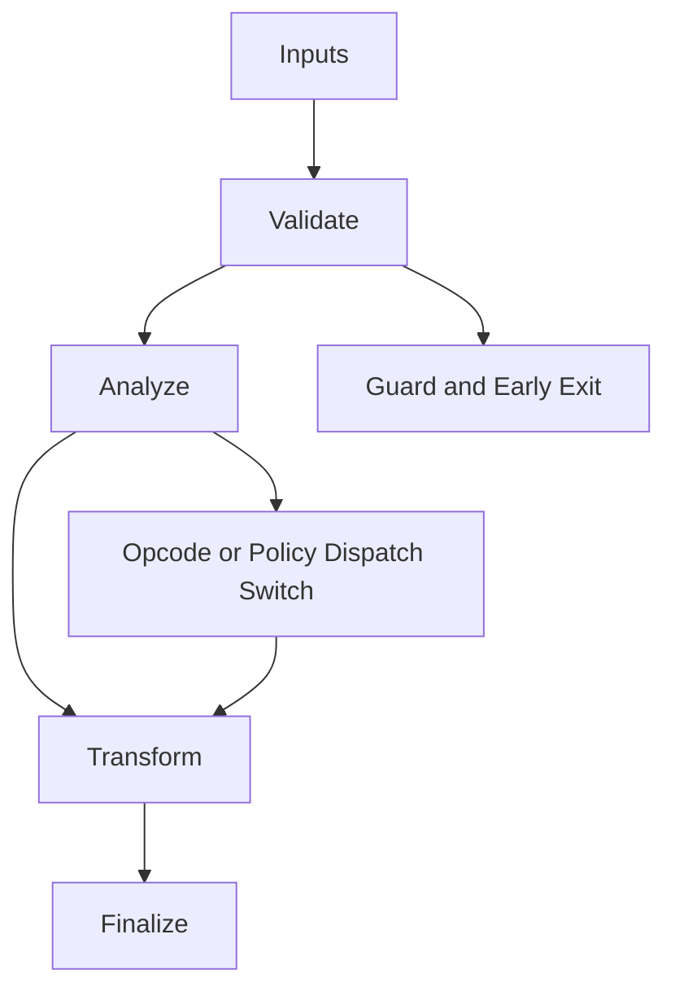

# Verified_Formal.hpp

Source Header: include/dgtl/core/Verified_Formal.hpp
Last Synced: 2026-04-14 19:46:40

## Vision
This component exists to make the compiler/runtime pipeline explicit, safe, and predictable under high-performance constraints.

## Why This File Exists
- Provide foundational contracts for memory, validation, target behavior, and shared compiler state.
- Keep responsibilities localized so surrounding passes and backends can compose without hidden coupling.
- Preserve correctness with explicit guardrails before optimization gains.
- Sentinel-style integrity checks are intentionally present to detect corruption before commit stages.

## Core Logic
- Inputs are validated early and non-actionable states return fast.
- Main logic operates on typed IR structures and explicit state transitions.
- Dispatch logic uses explicit switching to keep opcode or policy behavior transparent.
- Structural hashes are refreshed or verified to preserve correctness across rewrites.
- The design favors deterministic transformations and bounded side effects.

## Control Flow Graph and Map

## Control Flow Narrative
- Entry points validate stream and state before any mutation or expensive work.
- Dispatch branches by opcode or strategy to keep behavior explicit and testable.

## Include Dependencies
- #include <array>
- #include <bitset>
- #include <optional>
- #include <bit>
- #include <cstring>
- #include <cstdint>
- #include "dgtl/ir/base/Global_IR.hpp"

## Class and Struct Catalog
### Classes
- class DGTLFormalVerifier {
### Structs
- struct SymbolicVal {
- struct ConstantResult {

## Enum Catalog
- none detected

## Function Catalog
- [[nodiscard]] static uint32_t compute_master_hash(const ir::IRNode& n) noexcept {
- return compute_master_hash_bits(n.opcode, n.op_a, n.op_b, n.op_c);
- SymbolicVal compute_symbolic(const ir::IRNode& node) const noexcept {

## Design Decisions and Whys
- Explicit typing across IR nodes and flags reduces hidden semantic drift.
- Guard checks prevent invalid states from propagating into emitters and runtime paths.
- Layered modules allow policy evolution in pass and pipeline without backend rewrites.

## Critical Invariants
- Intent hash values must be consistent with opcode and operands after mutation.
- Null or invalid sentinel states must be short-circuited early.

## Practical Reading Order
- Start with type and enum declarations.
- Follow entry functions for control-flow intent.
- Then inspect helper methods for safety and transformation details.
