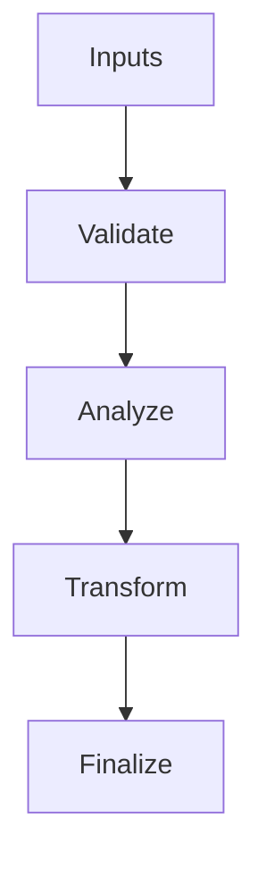

# Execution_Graph.hpp

Source Header: include/dgtl/graph/Execution_Graph.hpp
Last Synced: 2026-04-14 19:46:40

## Vision
This component exists to make the compiler/runtime pipeline explicit, safe, and predictable under high-performance constraints.

## Why This File Exists
- Model execution structure and dependencies to enable region-level scheduling and fusion.
- Keep responsibilities localized so surrounding passes and backends can compose without hidden coupling.
- Preserve correctness with explicit guardrails before optimization gains.
- Region-level modeling here enables larger-than-instruction scheduling and fusion decisions.

## Core Logic
- Inputs are validated early and non-actionable states return fast.
- Main logic operates on typed IR structures and explicit state transitions.
- The design favors deterministic transformations and bounded side effects.

## Control Flow Graph and Map

## Control Flow Narrative
- Entry points validate stream and state before any mutation or expensive work.

## Include Dependencies
- #include <vector>
- #include <memory>
- #include "dgtl/ir/base/Global_IR.hpp"
- #include "dgtl/core/Target.hpp"
- #include "Region.hpp"

## Class and Struct Catalog
### Classes
- class ExecutionGraph {

## Enum Catalog
- none detected

## Function Catalog
- void build_from_ir(dgtl::ir::IRStream& global_ir);
- void schedule(const dgtl::core::TargetMachine& target);
- std::vector<std::vector<Region*>> find_fusion_candidates() const;
- bool validate() const;
- [[nodiscard]] double region_schedule_score(const Region& region, const dgtl::core::TargetMachine& target) const {

## Design Decisions and Whys
- Explicit typing across IR nodes and flags reduces hidden semantic drift.
- Guard checks prevent invalid states from propagating into emitters and runtime paths.
- Layered modules allow policy evolution in pass and pipeline without backend rewrites.

## Critical Invariants
- Public operations should preserve deterministic behavior for equivalent inputs.

## Practical Reading Order
- Start with type and enum declarations.
- Follow entry functions for control-flow intent.
- Then inspect helper methods for safety and transformation details.
