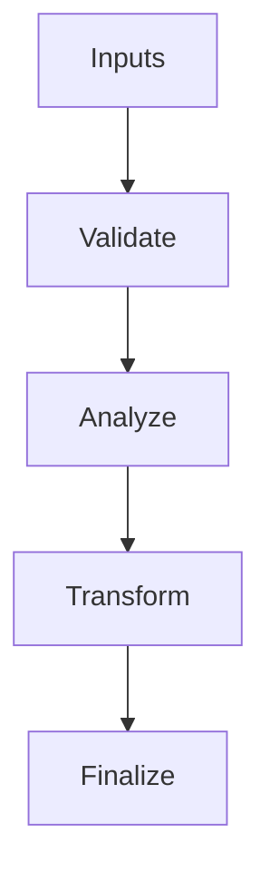

# Region.hpp

Source Header: include/dgtl/graph/Region.hpp
Last Synced: 2026-04-14 19:46:40

## Vision
This component exists to make the compiler/runtime pipeline explicit, safe, and predictable under high-performance constraints.

## Why This File Exists
- Model execution structure and dependencies to enable region-level scheduling and fusion.
- Keep responsibilities localized so surrounding passes and backends can compose without hidden coupling.
- Preserve correctness with explicit guardrails before optimization gains.
- Region-level modeling here enables larger-than-instruction scheduling and fusion decisions.

## Core Logic
- Inputs are validated early and non-actionable states return fast.
- Main logic operates on typed IR structures and explicit state transitions.
- The design favors deterministic transformations and bounded side effects.

## Control Flow Graph and Map

## Control Flow Narrative
- Entry points validate stream and state before any mutation or expensive work.

## Include Dependencies
- #include <vector>
- #include <unordered_set>
- #include "dgtl/ir/base/IR_Types.hpp"
- #include "dgtl/ir/base/IR_Nodes.hpp"
- #include "dgtl/ir/base/IR_Traits.hpp"

## Class and Struct Catalog
### Classes
- class Region {

## Enum Catalog
- none detected

## Function Catalog
- void add_node(const dgtl::ir::IRNode& node);
- void add_dependency(Region* dep);
- bool can_fuse_with(const Region& other) const;
- std::unordered_set<uint32_t> get_live_ins() const;
- std::unordered_set<uint32_t> get_live_outs() const;
- bool validate() const;
- [[nodiscard]] size_t node_count() const noexcept;
- [[nodiscard]] double simd_density() const noexcept;
- [[nodiscard]] double memory_density() const noexcept;
- [[nodiscard]] double control_density() const noexcept;
- [[nodiscard]] double live_range_pressure() const;

## Design Decisions and Whys
- Explicit typing across IR nodes and flags reduces hidden semantic drift.
- Guard checks prevent invalid states from propagating into emitters and runtime paths.
- Layered modules allow policy evolution in pass and pipeline without backend rewrites.

## Critical Invariants
- Public operations should preserve deterministic behavior for equivalent inputs.

## Practical Reading Order
- Start with type and enum declarations.
- Follow entry functions for control-flow intent.
- Then inspect helper methods for safety and transformation details.
