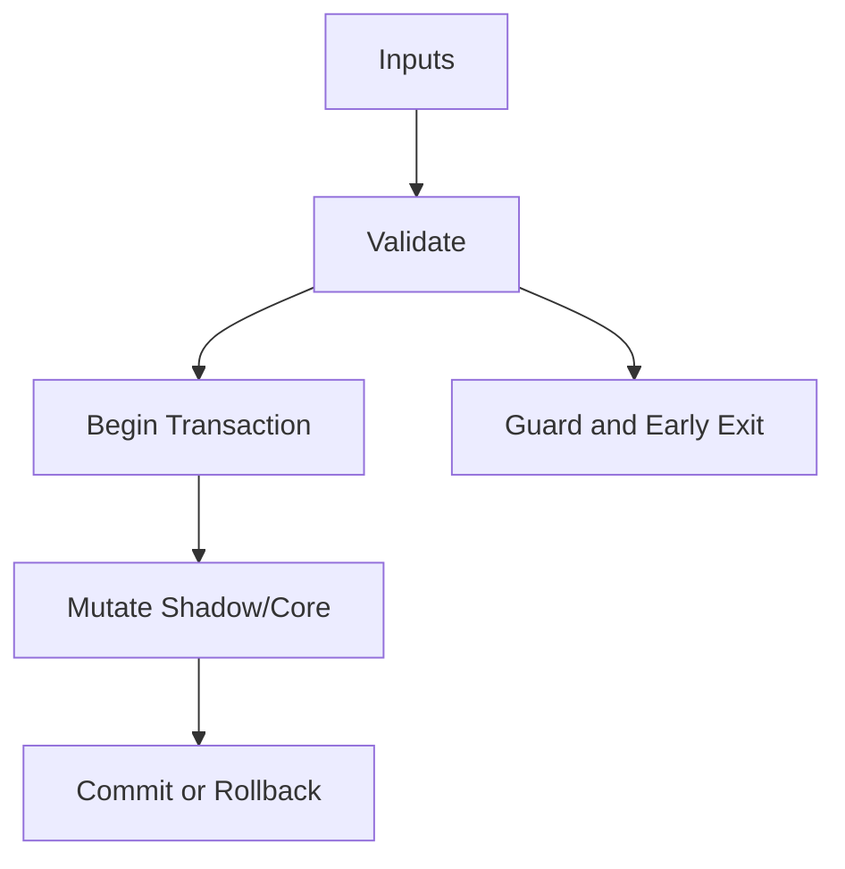

# IR_Stream.hpp

Source Header: include/dgtl/ir/base/IR_Stream.hpp
Last Synced: 2026-04-14 19:46:40

## Vision
This component exists to make the compiler/runtime pipeline explicit, safe, and predictable under high-performance constraints.

## Why This File Exists
- Represent program semantics in compact, verifiable IR forms suitable for transformation and emission.
- Keep responsibilities localized so surrounding passes and backends can compose without hidden coupling.
- Preserve correctness with explicit guardrails before optimization gains.
- IR contracts here define semantic invariants every pass and emitter relies on.
- Sentinel-style integrity checks are intentionally present to detect corruption before commit stages.

## Core Logic
- Inputs are validated early and non-actionable states return fast.
- Main logic operates on typed IR structures and explicit state transitions.
- Transactional semantics are present: begin, mutate, validate, then commit or rollback.
- Defensive error paths are explicit to prevent silent corruption propagation.

## Control Flow Graph and Map

## Control Flow Narrative
- Entry points validate stream and state before any mutation or expensive work.
- Mutation paths are transactional to ensure safe rollback on validation failure.

## Include Dependencies
- #include "IR_Types.hpp"
- #include "IR_Nodes.hpp"
- #include "IR_Traits.hpp"
- #include "IR_Storage.hpp"
- #include "dgtl/core/Arena.hpp"

## Class and Struct Catalog
### Classes
- class alignas(64) IRStream {
### Structs
- struct Iterator {
- struct IRTransactionGuard {

## Enum Catalog
- none detected

## Function Catalog
- [[nodiscard]] bool is_null() const noexcept;
- void set_count(size_t v) noexcept;
- [[nodiscard]] IRNode get_node(size_t idx) const noexcept;
- [[nodiscard]] IRNode& get_node_ref(size_t idx) noexcept;
- [[nodiscard]] const IRAtom& get_atom_readonly(size_t idx) const noexcept;
- [[nodiscard]] const IRCore& get_core_readonly(size_t idx) const noexcept;
- void push_node(const IRAtom& atom, const IRCore& core) noexcept;
- void push_node(OpCode op, uint16_t fl, uint32_t res, uint32_t a, uint32_t b, uint32_t c, uint32_t h = 0) noexcept;
- void push_back(const IRNode& node) noexcept;
- void begin_transaction() noexcept;
- void commit_transaction() noexcept;
- void rollback_transaction() noexcept;
- void abort_transaction() noexcept;
- void prune_shadow_buffer() noexcept;
- void push_full_to_shadow() noexcept;
- void commit_from_shadow(IRStream& shadow_stream) noexcept;
- void commit_from_shadow() noexcept;
- uint32_t reserve_shadow_slot() noexcept;
- void push_to_shadow(const IRNode& node) noexcept;
- [[nodiscard]] IRNode get_shadow_node_proxy(size_t idx) const noexcept;
- [[nodiscard]] IRNode* get_buffer_ptr() const noexcept;
- static IRStream allocate_shadow(size_t size);
- void copy_from(const IRStream& other);
- IRStream clone() const;
- [[nodiscard]] bool validate_shadow_integrity() const noexcept;
- [[nodiscard]] uint64_t generate_logic_hash() const noexcept;
- void push_shadow_fold(const IRNode& node) noexcept;
- void perform_dead_code_elimination() noexcept;
- void perform_gvn() noexcept;
- void set_shadow_count(size_t val) noexcept;
- void update_shadow_size(size_t s) noexcept;
- [[nodiscard]] uint32_t intent_crc() const noexcept;
- [[nodiscard]] uint32_t get_max_id() const noexcept;
- void evolve_node(IRNode* node);
- static IRStream allocate_transactional(size_t size);
- explicit IRTransactionGuard(IRStream& s) : stream(s) {
- void commit() {

## Design Decisions and Whys
- Explicit typing across IR nodes and flags reduces hidden semantic drift.
- Guard checks prevent invalid states from propagating into emitters and runtime paths.
- Layered modules allow policy evolution in pass and pipeline without backend rewrites.

## Critical Invariants
- Shadow integrity must validate before state is committed.
- Transaction boundaries must remain balanced across success and failure paths.
- Null or invalid sentinel states must be short-circuited early.

## Practical Reading Order
- Start with type and enum declarations.
- Follow entry functions for control-flow intent.
- Then inspect helper methods for safety and transformation details.
