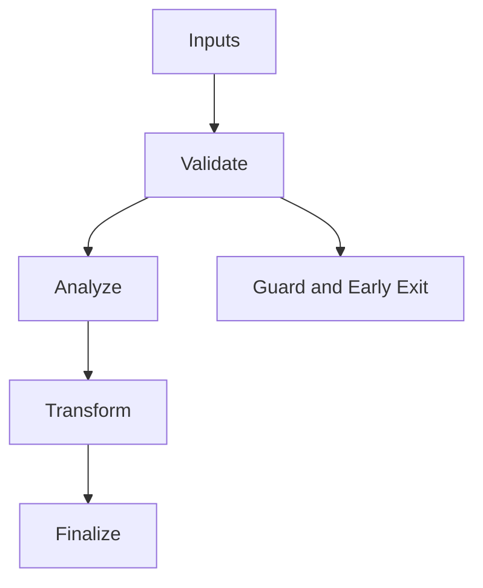

# IR_Types.hpp

Source Header: include/dgtl/ir/base/IR_Types.hpp
Last Synced: 2026-04-14 19:46:40

## Vision
This component exists to make the compiler/runtime pipeline explicit, safe, and predictable under high-performance constraints.

## Why This File Exists
- Represent program semantics in compact, verifiable IR forms suitable for transformation and emission.
- Keep responsibilities localized so surrounding passes and backends can compose without hidden coupling.
- Preserve correctness with explicit guardrails before optimization gains.
- IR contracts here define semantic invariants every pass and emitter relies on.
- Sentinel-style integrity checks are intentionally present to detect corruption before commit stages.

## Core Logic
- Inputs are validated early and non-actionable states return fast.
- Main logic operates on typed IR structures and explicit state transitions.
- Structural hashes are refreshed or verified to preserve correctness across rewrites.
- The design favors deterministic transformations and bounded side effects.

## Control Flow Graph and Map

## Control Flow Narrative
- Entry points validate stream and state before any mutation or expensive work.

## Include Dependencies
- #include <cstdint>
- #include <bit>

## Class and Struct Catalog
### Structs
- struct IRCore {
- struct IRAtom {
- struct ExtendedFlags {
- struct AtomSplitter {

## Enum Catalog
- enum class OpCode : uint16_t {

## Function Catalog
- constexpr operator uint32_t() const noexcept {
- static constexpr IRAtom pack(OpCode op, uint16_t flags) noexcept {
- return IRAtom(op, flags);
- static constexpr IRAtom pack(uint32_t value) noexcept {
- return IRAtom(static_cast<OpCode>(value >> 16), static_cast<uint16_t>(value & 0xFFFF));

## Design Decisions and Whys
- Explicit typing across IR nodes and flags reduces hidden semantic drift.
- Guard checks prevent invalid states from propagating into emitters and runtime paths.
- Layered modules allow policy evolution in pass and pipeline without backend rewrites.

## Critical Invariants
- Intent hash values must be consistent with opcode and operands after mutation.
- Null or invalid sentinel states must be short-circuited early.

## Practical Reading Order
- Start with type and enum declarations.
- Follow entry functions for control-flow intent.
- Then inspect helper methods for safety and transformation details.
