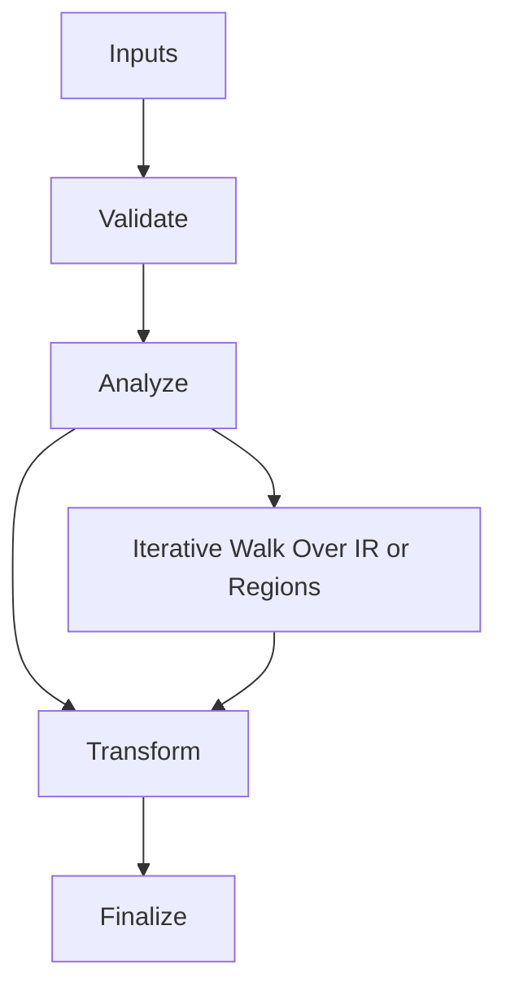

# TLS_Flush_Merge.hpp

Source Header: include/dgtl/ir/runtime.hpp/TLS_Flush_Merge.hpp
Last Synced: 2026-04-14 19:46:40

## Vision
This component exists to make the compiler/runtime pipeline explicit, safe, and predictable under high-performance constraints.

## Why This File Exists
- Drive runtime execution, specialization, and backend dispatch with predictable safety checks.
- Keep responsibilities localized so surrounding passes and backends can compose without hidden coupling.
- Preserve correctness with explicit guardrails before optimization gains.
- This file captures a focused subsystem contract so complexity does not leak across module boundaries.

## Core Logic
- Inputs are validated early and non-actionable states return fast.
- Main logic operates on typed IR structures and explicit state transitions.
- Traversal is iterative to keep performance linear over stream and region size.
- The design favors deterministic transformations and bounded side effects.

## Control Flow Graph and Map

## Control Flow Narrative
- Entry points validate stream and state before any mutation or expensive work.
- Processing is mainly loop-driven to walk nodes, regions, or dependency structures.

## Include Dependencies
- #include <mutex>
- #include "dgtl/core/Context.hpp"        // brings g_tls_buffer
- #include "dgtl/ir/base/Global_IR.hpp"

## Class and Struct Catalog
### Classes
- class TLSFlushMerge {

## Enum Catalog
- none detected

## Function Catalog
- void flush_primary(ir::IRStream& global_stream) noexcept {
- std::lock_guard<std::mutex> lock(merge_mutex);
- void flush_shadow(ir::IRStream& global_stream) noexcept {

## Design Decisions and Whys
- Explicit typing across IR nodes and flags reduces hidden semantic drift.
- Guard checks prevent invalid states from propagating into emitters and runtime paths.
- Layered modules allow policy evolution in pass and pipeline without backend rewrites.

## Critical Invariants
- Public operations should preserve deterministic behavior for equivalent inputs.

## Practical Reading Order
- Start with type and enum declarations.
- Follow entry functions for control-flow intent.
- Then inspect helper methods for safety and transformation details.
