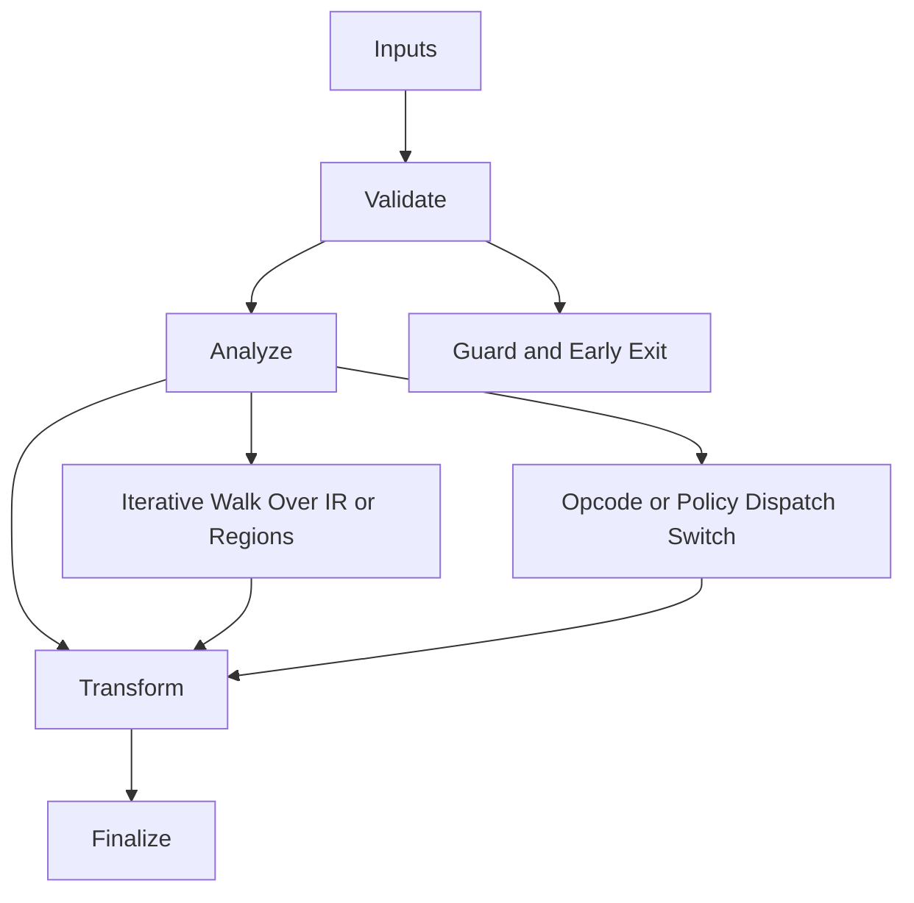

# ARM64_Emitter.hpp

Source Header: include/dgtl/isa/emitter/ARM64_Emitter.hpp
Last Synced: 2026-04-14 19:46:40

## Vision
This component exists to make the compiler/runtime pipeline explicit, safe, and predictable under high-performance constraints.

## Why This File Exists
- Lower IR into target-specific representation while preserving semantic correctness and backend constraints.
- Keep responsibilities localized so surrounding passes and backends can compose without hidden coupling.
- Preserve correctness with explicit guardrails before optimization gains.
- Backend lowering is explicit here to keep architecture behavior auditable and deterministic.
- Sentinel-style integrity checks are intentionally present to detect corruption before commit stages.

## Core Logic
- Inputs are validated early and non-actionable states return fast.
- Main logic operates on typed IR structures and explicit state transitions.
- Traversal is iterative to keep performance linear over stream and region size.
- Dispatch logic uses explicit switching to keep opcode or policy behavior transparent.
- Structural hashes are refreshed or verified to preserve correctness across rewrites.
- The design favors deterministic transformations and bounded side effects.

## Control Flow Graph and Map

## Control Flow Narrative
- Entry points validate stream and state before any mutation or expensive work.
- Processing is mainly loop-driven to walk nodes, regions, or dependency structures.
- Dispatch branches by opcode or strategy to keep behavior explicit and testable.

## Include Dependencies
- #include <cstdint>
- #include <ostream>
- #include <iomanip>
- #include <string>
- #include "dgtl/ir/base/Global_IR.hpp"
- #include "dgtl/core/Target.hpp"
- #include "dgtl/core/Symbol_Table.hpp"

## Class and Struct Catalog
### Classes
- class alignas(64) ARM64Emitter {
### Structs
- struct Config {

## Enum Catalog
- none detected

## Function Catalog
- void emit_assembly(std::ostream& out, const Config config = {}) {
- void emit_header(std::ostream& out, const Config& config) {
- void emit_footer(std::ostream& out, const Config& config) {
- void emit_arithmetic(std::ostream& out, const char* instr, const IRCore& core, bool is_fp = false) {
- void emit_move(std::ostream& out, const IRCore& core) {
- void emit_shift_left(std::ostream& out, const IRCore& core) {
- void emit_fma(std::ostream& out, const IRCore& core) {
- void emit_load_imm(std::ostream& out, const IRCore& core) {
- void emit_load(std::ostream& out, const IRCore& core) {
- void emit_store(std::ostream& out, const IRCore& core) {
- void emit_neon_vec_op(std::ostream& out, const char* instr, const IRCore& core) {
- void emit_branch(std::ostream& out, const IRCore& core) {
- void emit_branch_cond(std::ostream& out, const IRCore& core) {
- void emit_call(std::ostream& out, const IRCore& core) {
- void emit_syscall(std::ostream& out) {
- void emit_bitfield_insert(std::ostream& out, const IRCore& core) {
- void emit_bitfield_extract(std::ostream& out, const IRCore& core) {
- void emit_fallback(std::ostream& out, OpCode opcode) {
- void emit_ret(std::ostream& out, const IRCore& core) {

## Design Decisions and Whys
- Explicit typing across IR nodes and flags reduces hidden semantic drift.
- Guard checks prevent invalid states from propagating into emitters and runtime paths.
- Layered modules allow policy evolution in pass and pipeline without backend rewrites.

## Critical Invariants
- Intent hash values must be consistent with opcode and operands after mutation.
- Null or invalid sentinel states must be short-circuited early.

## Practical Reading Order
- Start with type and enum declarations.
- Follow entry functions for control-flow intent.
- Then inspect helper methods for safety and transformation details.
