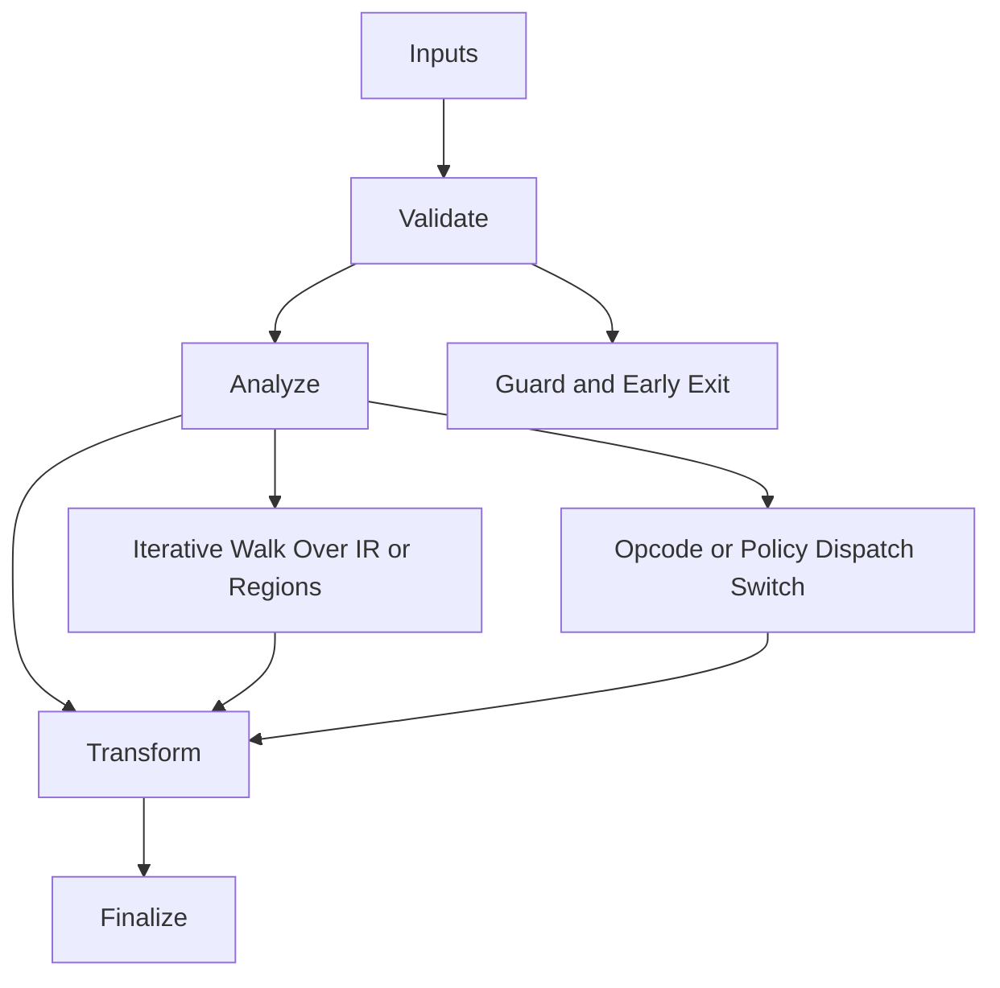

# GPGPU_Fusion_FastEmission.hpp

Source Header: include/dgtl/isa/emitter/GPGPU_Fusion_FastEmission.hpp
Last Synced: 2026-04-14 19:46:41

## Vision
This component exists to make the compiler/runtime pipeline explicit, safe, and predictable under high-performance constraints.

## Why This File Exists
- Lower IR into target-specific representation while preserving semantic correctness and backend constraints.
- Keep responsibilities localized so surrounding passes and backends can compose without hidden coupling.
- Preserve correctness with explicit guardrails before optimization gains.
- Region-level modeling here enables larger-than-instruction scheduling and fusion decisions.
- Backend lowering is explicit here to keep architecture behavior auditable and deterministic.

## Core Logic
- Inputs are validated early and non-actionable states return fast.
- Main logic operates on typed IR structures and explicit state transitions.
- Traversal is iterative to keep performance linear over stream and region size.
- Dispatch logic uses explicit switching to keep opcode or policy behavior transparent.
- The design favors deterministic transformations and bounded side effects.

## Control Flow Graph and Map

## Control Flow Narrative
- Entry points validate stream and state before any mutation or expensive work.
- Processing is mainly loop-driven to walk nodes, regions, or dependency structures.
- Dispatch branches by opcode or strategy to keep behavior explicit and testable.

## Include Dependencies
- #include <cstdint>
- #include <vector>
- #include <string>
- #include <string_view>
- #include <memory>
- #include "dgtl/ir/base/Global_IR.hpp"
- #include "dgtl/core/Target.hpp"

## Class and Struct Catalog
### Classes
- class alignas(64) GPGPUFusionEngine {
### Structs
- struct alignas(16) GridConfig {
- struct FusionResult {

## Enum Catalog
- enum class DeviceType : uint8_t {
- enum class FusionStatus : uint32_t {

## Function Catalog
- [[nodiscard]] std::string fuse_to_source(const IRStream& stream) {
- FusionResult dispatch_fusion(const IRStream& stream, const GridConfig& config) {
- void emit_kernel_header(std::string& src) {
- bool emit_node_logic(std::string& src, const IRNode& node) {
- void emit_kernel_footer(std::string& src) {

## Design Decisions and Whys
- Explicit typing across IR nodes and flags reduces hidden semantic drift.
- Guard checks prevent invalid states from propagating into emitters and runtime paths.
- Layered modules allow policy evolution in pass and pipeline without backend rewrites.

## Critical Invariants
- Null or invalid sentinel states must be short-circuited early.

## Practical Reading Order
- Start with type and enum declarations.
- Follow entry functions for control-flow intent.
- Then inspect helper methods for safety and transformation details.
