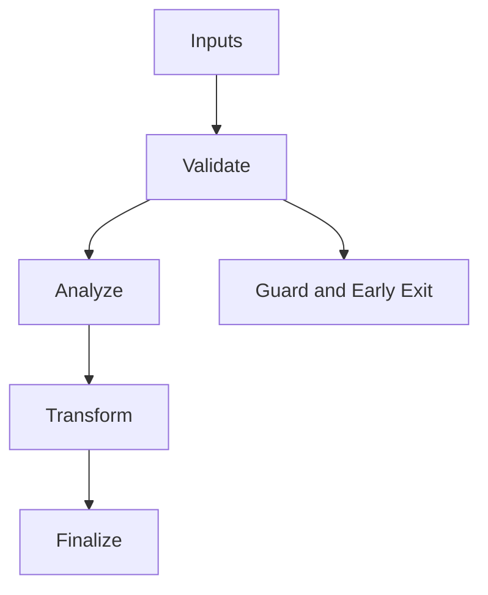

# MachOs_Emitter.hpp

Source Header: include/dgtl/isa/emitter/MachOs_Emitter.hpp
Last Synced: 2026-04-14 19:46:41

## Vision
This component exists to make the compiler/runtime pipeline explicit, safe, and predictable under high-performance constraints.

## Why This File Exists
- Lower IR into target-specific representation while preserving semantic correctness and backend constraints.
- Keep responsibilities localized so surrounding passes and backends can compose without hidden coupling.
- Preserve correctness with explicit guardrails before optimization gains.
- Backend lowering is explicit here to keep architecture behavior auditable and deterministic.

## Core Logic
- Inputs are validated early and non-actionable states return fast.
- Main logic operates on typed IR structures and explicit state transitions.
- The design favors deterministic transformations and bounded side effects.

## Control Flow Graph and Map

## Control Flow Narrative
- Entry points validate stream and state before any mutation or expensive work.

## Include Dependencies
- #include <vector>
- #include <string>
- #include <fstream>
- #include <cstring>
- #include "dgtl/ir/base/Global_IR.hpp"
- #include "dgtl/isa/emitter/ARM64_Emitter.hpp"

## Class and Struct Catalog
### Classes
- class alignas(64) MachOEmitter {
### Structs
- struct alignas(8) MachOHeader64 {
- struct MachOResult {

## Enum Catalog
- none detected

## Function Catalog
- MachOResult emit_to_binary() {
- bool save_to_file(const std::string& filename) {
- std::ofstream file(filename, std::ios::binary);
- std::vector<uint8_t> generate_machine_code() {

## Design Decisions and Whys
- Explicit typing across IR nodes and flags reduces hidden semantic drift.
- Guard checks prevent invalid states from propagating into emitters and runtime paths.
- Layered modules allow policy evolution in pass and pipeline without backend rewrites.

## Critical Invariants
- Null or invalid sentinel states must be short-circuited early.

## Practical Reading Order
- Start with type and enum declarations.
- Follow entry functions for control-flow intent.
- Then inspect helper methods for safety and transformation details.
