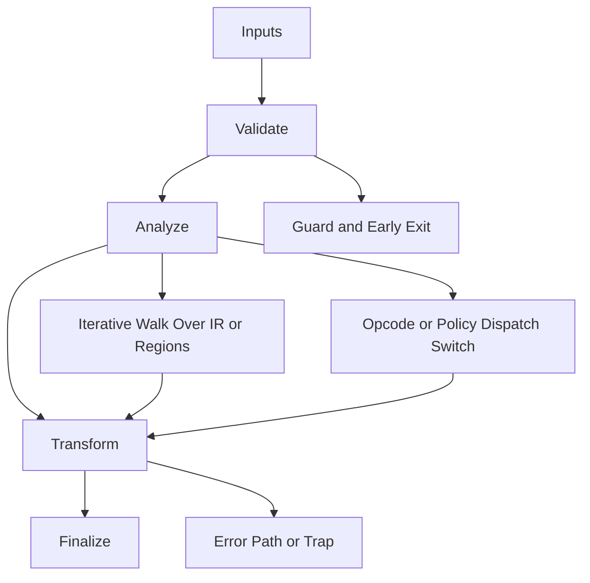

# Wasm_Target.hpp

Source Header: include/dgtl/isa/target/Wasm_Target.hpp
Last Synced: 2026-04-14 19:46:41

## Vision
This component exists to make the compiler/runtime pipeline explicit, safe, and predictable under high-performance constraints.

## Why This File Exists
- Lower IR into target-specific representation while preserving semantic correctness and backend constraints.
- Keep responsibilities localized so surrounding passes and backends can compose without hidden coupling.
- Preserve correctness with explicit guardrails before optimization gains.
- Backend lowering is explicit here to keep architecture behavior auditable and deterministic.
- Sentinel-style integrity checks are intentionally present to detect corruption before commit stages.

## Core Logic
- Inputs are validated early and non-actionable states return fast.
- Main logic operates on typed IR structures and explicit state transitions.
- Traversal is iterative to keep performance linear over stream and region size.
- Dispatch logic uses explicit switching to keep opcode or policy behavior transparent.
- The design favors deterministic transformations and bounded side effects.
- Defensive error paths are explicit to prevent silent corruption propagation.

## Control Flow Graph and Map

## Control Flow Narrative
- Entry points validate stream and state before any mutation or expensive work.
- Processing is mainly loop-driven to walk nodes, regions, or dependency structures.
- Dispatch branches by opcode or strategy to keep behavior explicit and testable.
- Failure branches escalate with explicit errors or traps when invariants are violated.

## Include Dependencies
- #include <cstdint>
- #include <string>
- #include <cstring>
- #include <vector>
- #include <stdexcept>
- #include "dgtl/ir/base/Global_IR.hpp"

## Class and Struct Catalog
### Classes
- class DGTLAsmEmitter {
### Structs
- struct mach_header_64 {
- struct segment_command_64 {
- struct entry_point_command {
- struct WasmHeader {

## Enum Catalog
- none detected

## Function Catalog
- static void to_nasm(const ir::IRStream& stream, std::string& out) {
- static std::vector<uint8_t> emit_macho_binary(const std::vector<uint32_t>& machine_code) {
- static void verify_DGTL_invariants(const ir::IRStream& stream) {

## Design Decisions and Whys
- Explicit typing across IR nodes and flags reduces hidden semantic drift.
- Guard checks prevent invalid states from propagating into emitters and runtime paths.
- Layered modules allow policy evolution in pass and pipeline without backend rewrites.

## Critical Invariants
- Null or invalid sentinel states must be short-circuited early.
- Error paths must fail loudly to avoid silent semantic drift.

## Practical Reading Order
- Start with type and enum declarations.
- Follow entry functions for control-flow intent.
- Then inspect helper methods for safety and transformation details.
