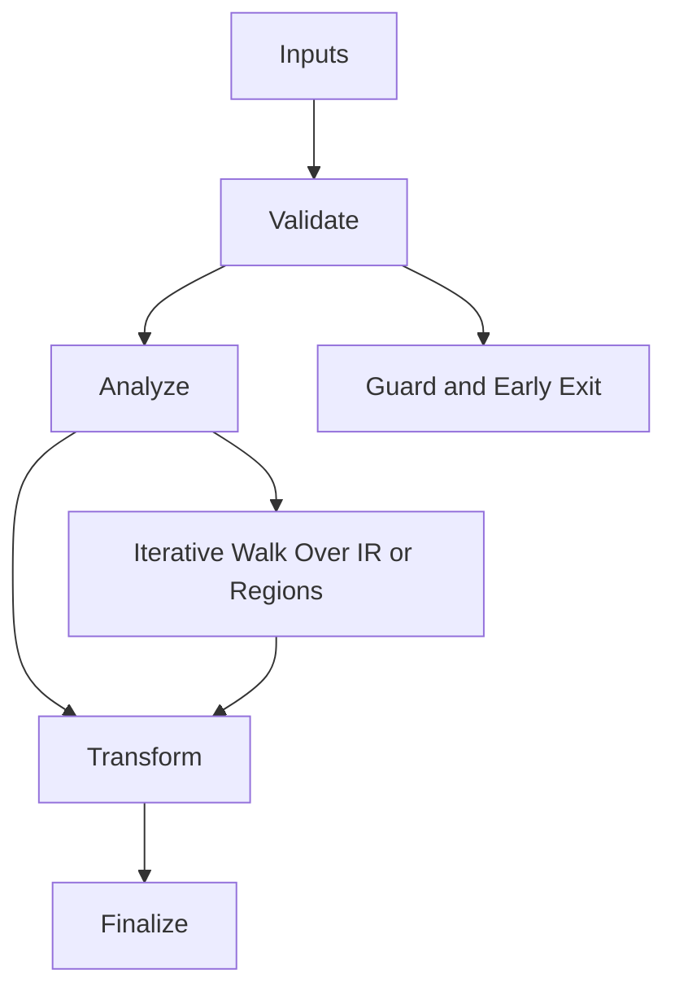

# Strike_Orchestrator.hpp

Source Header: include/dgtl/jit/orchestrator/Strike_Orchestrator.hpp
Last Synced: 2026-04-14 19:46:41

## Vision
This component exists to make the compiler/runtime pipeline explicit, safe, and predictable under high-performance constraints.

## Why This File Exists
- Drive runtime execution, specialization, and backend dispatch with predictable safety checks.
- Keep responsibilities localized so surrounding passes and backends can compose without hidden coupling.
- Preserve correctness with explicit guardrails before optimization gains.
- Runtime orchestration is partitioned to separate policy selection from execution mechanics.

## Core Logic
- Inputs are validated early and non-actionable states return fast.
- Main logic operates on typed IR structures and explicit state transitions.
- Traversal is iterative to keep performance linear over stream and region size.
- The design favors deterministic transformations and bounded side effects.

## Control Flow Graph and Map

## Control Flow Narrative
- Entry points validate stream and state before any mutation or expensive work.
- Processing is mainly loop-driven to walk nodes, regions, or dependency structures.

## Include Dependencies
- #include <vector>
- #include <cstdint>
- #include "dgtl/core/Context.hpp"
- #include "dgtl/ir/base/Global_IR.hpp"
- #include "dgtl/isa/lowering/Stack_Spiller.hpp"
- #include "dgtl/isa/emitter/X64_Strike_Emitter.hpp"
- #include "dgtl/jit/orchestrator/Strike_Runner.hpp"
- #include "dgtl/analysis/cost/AI_Cost_Model.hpp"
- #include "dgtl/jit/runtime/JIT_Executor.hpp"

## Class and Struct Catalog
### Classes
- class StrikeOrchestrator {

## Enum Catalog
- none detected

## Function Catalog
- dgtl::exec::StrikeMetrics fire_strike(ir::IRStream& stream, void* data_payload = nullptr) {
- void hard_reset() {
- [[nodiscard]] uint32_t get_stack_frame_requirement() const noexcept {

## Design Decisions and Whys
- Explicit typing across IR nodes and flags reduces hidden semantic drift.
- Guard checks prevent invalid states from propagating into emitters and runtime paths.
- Layered modules allow policy evolution in pass and pipeline without backend rewrites.

## Critical Invariants
- Null or invalid sentinel states must be short-circuited early.

## Practical Reading Order
- Start with type and enum declarations.
- Follow entry functions for control-flow intent.
- Then inspect helper methods for safety and transformation details.
