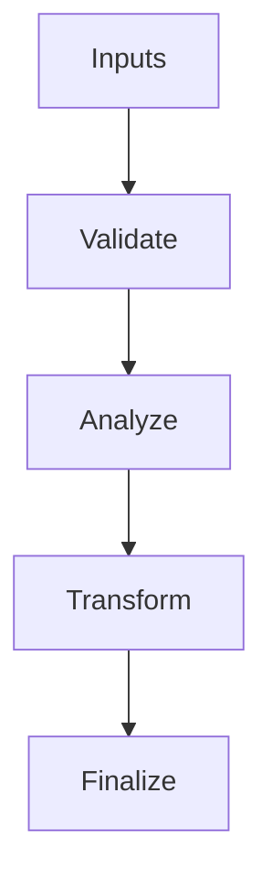

# Strike_Runner.hpp

Source Header: include/dgtl/jit/orchestrator/Strike_Runner.hpp
Last Synced: 2026-04-14 19:46:41

## Vision
This component exists to make the compiler/runtime pipeline explicit, safe, and predictable under high-performance constraints.

## Why This File Exists
- Drive runtime execution, specialization, and backend dispatch with predictable safety checks.
- Keep responsibilities localized so surrounding passes and backends can compose without hidden coupling.
- Preserve correctness with explicit guardrails before optimization gains.
- Runtime orchestration is partitioned to separate policy selection from execution mechanics.

## Core Logic
- Inputs are validated early and non-actionable states return fast.
- Main logic operates on typed IR structures and explicit state transitions.
- The design favors deterministic transformations and bounded side effects.

## Control Flow Graph and Map

## Control Flow Narrative
- Entry points validate stream and state before any mutation or expensive work.

## Include Dependencies
- #include <cstdint>
- #include <vector>
- #include "dgtl/core/Arena.hpp"

## Class and Struct Catalog
### Classes
- class StrikeRunner {
### Structs
- struct StrikeMetrics {

## Enum Catalog
- enum class StrikeStatus : uint32_t {

## Function Catalog
- static size_t inject_code(dgtl::core::DGTL_Arena& arena, const std::vector<uint8_t>& machine_code);
- static uintptr_t last_injected_address() noexcept;
- static StrikeMetrics execute(dgtl::core::DGTL_Arena& arena, size_t injected_size, void* payload);

## Design Decisions and Whys
- Explicit typing across IR nodes and flags reduces hidden semantic drift.
- Guard checks prevent invalid states from propagating into emitters and runtime paths.
- Layered modules allow policy evolution in pass and pipeline without backend rewrites.

## Critical Invariants
- Public operations should preserve deterministic behavior for equivalent inputs.

## Practical Reading Order
- Start with type and enum declarations.
- Follow entry functions for control-flow intent.
- Then inspect helper methods for safety and transformation details.
