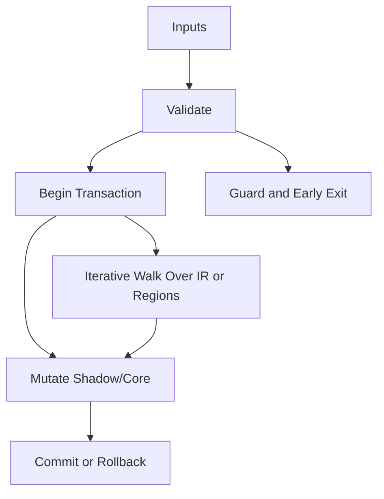

# Speculative_DCE.hpp

Source Header: include/dgtl/pass/speculative/Speculative_DCE.hpp
Last Synced: 2026-04-14 19:46:42

## Vision
This component exists to make the compiler/runtime pipeline explicit, safe, and predictable under high-performance constraints.

## Why This File Exists
- Apply correctness-preserving transformations to improve cost, latency, and code quality.
- Keep responsibilities localized so surrounding passes and backends can compose without hidden coupling.
- Preserve correctness with explicit guardrails before optimization gains.
- Transformation safety is bounded here through checks that preserve IR validity and intent.
- Sentinel-style integrity checks are intentionally present to detect corruption before commit stages.

## Core Logic
- Inputs are validated early and non-actionable states return fast.
- Main logic operates on typed IR structures and explicit state transitions.
- Traversal is iterative to keep performance linear over stream and region size.
- Structural hashes are refreshed or verified to preserve correctness across rewrites.
- Transactional semantics are present: begin, mutate, validate, then commit or rollback.
- Defensive error paths are explicit to prevent silent corruption propagation.

## Control Flow Graph and Map

## Control Flow Narrative
- Entry points validate stream and state before any mutation or expensive work.
- Processing is mainly loop-driven to walk nodes, regions, or dependency structures.
- Mutation paths are transactional to ensure safe rollback on validation failure.

## Include Dependencies
- #include <vector>
- #include <algorithm>
- #include <cstring>
- #include <stdexcept>
- #include "dgtl/ir/base/Global_IR.hpp"
- #include "dgtl/pipeline/Pass_Manager.hpp"
- #include "dgtl/analysis/cost/AI_Cost_Model.hpp"
- #include "dgtl/core/Verified_Formal.hpp"

## Class and Struct Catalog
### Classes
- class DGTLSpeculativeDCE : public pipeline::DGTLOptimizationPass {
### Structs
- struct BlockProfile {

## Enum Catalog
- none detected

## Function Catalog
- void execute(ir::IRStream& stream) override {
- bool prune_and_reorder_transactional(ir::IRStream& stream, const analysis::DGTLAICostModel& ai_model) {
- std::vector<BlockProfile> analyze_cfg_probability(const ir::IRStream& s, const analysis::DGTLAICostModel& ai) {
- void finalize_shadow_node(ir::IRStream& s, uint32_t idx) noexcept {
- void append_block_to_shadow(ir::IRStream& s, uint32_t& cursor, const BlockProfile& p) noexcept {
- void align_shadow_to_cache_line(ir::IRStream& s, uint32_t& cursor) noexcept {
- void inject_branch_hint_shadow(ir::IRStream& s, uint32_t cursor, bool likely) noexcept {

## Design Decisions and Whys
- Explicit typing across IR nodes and flags reduces hidden semantic drift.
- Guard checks prevent invalid states from propagating into emitters and runtime paths.
- Layered modules allow policy evolution in pass and pipeline without backend rewrites.

## Critical Invariants
- Shadow integrity must validate before state is committed.
- Transaction boundaries must remain balanced across success and failure paths.
- Intent hash values must be consistent with opcode and operands after mutation.
- Null or invalid sentinel states must be short-circuited early.

## Practical Reading Order
- Start with type and enum declarations.
- Follow entry functions for control-flow intent.
- Then inspect helper methods for safety and transformation details.
