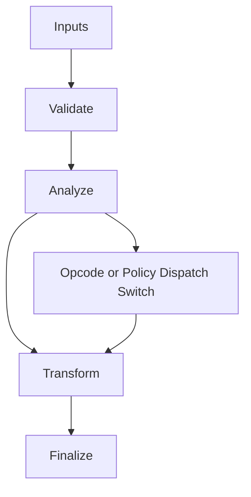

# Pass_Decision_Engine.hpp

Source Header: include/dgtl/pipeline/Pass_Decision_Engine.hpp
Last Synced: 2026-04-14 19:46:42

## Vision
This component exists to make the compiler/runtime pipeline explicit, safe, and predictable under high-performance constraints.

## Why This File Exists
- Apply correctness-preserving transformations to improve cost, latency, and code quality.
- Keep responsibilities localized so surrounding passes and backends can compose without hidden coupling.
- Preserve correctness with explicit guardrails before optimization gains.
- This file captures a focused subsystem contract so complexity does not leak across module boundaries.

## Core Logic
- Inputs are validated early and non-actionable states return fast.
- Main logic operates on typed IR structures and explicit state transitions.
- Dispatch logic uses explicit switching to keep opcode or policy behavior transparent.
- The design favors deterministic transformations and bounded side effects.

## Control Flow Graph and Map

## Control Flow Narrative
- Entry points validate stream and state before any mutation or expensive work.
- Dispatch branches by opcode or strategy to keep behavior explicit and testable.

## Include Dependencies
- #include <algorithm>
- #include <cmath>
- #include <vector>
- #include "dgtl/graph/Region.hpp"
- #include "dgtl/analysis/cost/AI_Cost_Model.hpp"
- #include "Pass_Manager.hpp"

## Class and Struct Catalog
### Classes
- class PassDecisionEngine {
### Structs
- struct RegionSignals {

## Enum Catalog
- none detected

## Function Catalog
- return predict_pass_benefit(a, region, cost_model) > predict_pass_benefit(b, region, cost_model);
- double affinity_weight(PassAffinity affinity) const {

## Design Decisions and Whys
- Explicit typing across IR nodes and flags reduces hidden semantic drift.
- Guard checks prevent invalid states from propagating into emitters and runtime paths.
- Layered modules allow policy evolution in pass and pipeline without backend rewrites.

## Critical Invariants
- Public operations should preserve deterministic behavior for equivalent inputs.

## Practical Reading Order
- Start with type and enum declarations.
- Follow entry functions for control-flow intent.
- Then inspect helper methods for safety and transformation details.
