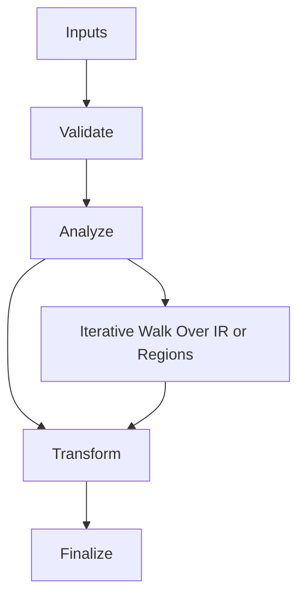

# Pass_Manager.hpp

Source Header: include/dgtl/pipeline/Pass_Manager.hpp
Last Synced: 2026-04-14 19:46:42

## Vision
This component exists to make the compiler/runtime pipeline explicit, safe, and predictable under high-performance constraints.

## Why This File Exists
- Apply correctness-preserving transformations to improve cost, latency, and code quality.
- Keep responsibilities localized so surrounding passes and backends can compose without hidden coupling.
- Preserve correctness with explicit guardrails before optimization gains.
- Sentinel-style integrity checks are intentionally present to detect corruption before commit stages.

## Core Logic
- Inputs are validated early and non-actionable states return fast.
- Main logic operates on typed IR structures and explicit state transitions.
- Traversal is iterative to keep performance linear over stream and region size.
- The design favors deterministic transformations and bounded side effects.

## Control Flow Graph and Map

## Control Flow Narrative
- Entry points validate stream and state before any mutation or expensive work.
- Processing is mainly loop-driven to walk nodes, regions, or dependency structures.

## Include Dependencies
- #include <array>
- #include <bitset>
- #include <optional>
- #include <bit>
- #include <cstring>
- #include <vector>
- #include <memory>
- #include <thread>
- #include "dgtl/ir/base/Global_IR.hpp"
- #include "dgtl/core/Verified_Formal.hpp"
- #include "dgtl/analysis/cost/AI_Cost_Model.hpp"
- #include "dgtl/graph/Region.hpp"

## Class and Struct Catalog
### Classes
- class DGTLLanguageRootMarker {
- class DGTLOptimizationPass {
- class DGTLoptManager {
### Structs
- struct PassExecutionPolicy {

## Enum Catalog
- enum class TargetPrecision {
- enum class PassStage : uint8_t {
- enum class PassAffinity : uint8_t {

## Function Catalog
- [[nodiscard]] virtual bool is_root(const ir::IRNode& node) const noexcept = 0;
- virtual void execute(ir::IRStream& stream) = 0;
- [[nodiscard]] virtual const char* get_pass_name() const noexcept = 0;
- void add_opt(std::unique_ptr<DGTLOptimizationPass> pass) {
- bool execute(ir::IRStream& stream, TargetPrecision precision) noexcept {
- bool execute(ir::IRStream& stream) noexcept {
- return execute(stream, TargetPrecision::HFT);
- [[nodiscard]] size_t pass_count() const noexcept {
- [[nodiscard]] TargetPrecision get_target() const noexcept {
- void set_execution_policy(const PassExecutionPolicy& p) noexcept {
- [[nodiscard]] PassExecutionPolicy get_execution_policy() const noexcept {
- void set_root_marker(const DGTLLanguageRootMarker* marker) noexcept {
- [[nodiscard]] const DGTLLanguageRootMarker* get_root_marker() const noexcept {
- void run_adaptive(ir::IRStream& stream, ::dgtl::analysis::DGTLAICostModel& cost_model);

## Design Decisions and Whys
- Explicit typing across IR nodes and flags reduces hidden semantic drift.
- Guard checks prevent invalid states from propagating into emitters and runtime paths.
- Layered modules allow policy evolution in pass and pipeline without backend rewrites.

## Critical Invariants
- Public operations should preserve deterministic behavior for equivalent inputs.

## Practical Reading Order
- Start with type and enum declarations.
- Follow entry functions for control-flow intent.
- Then inspect helper methods for safety and transformation details.
