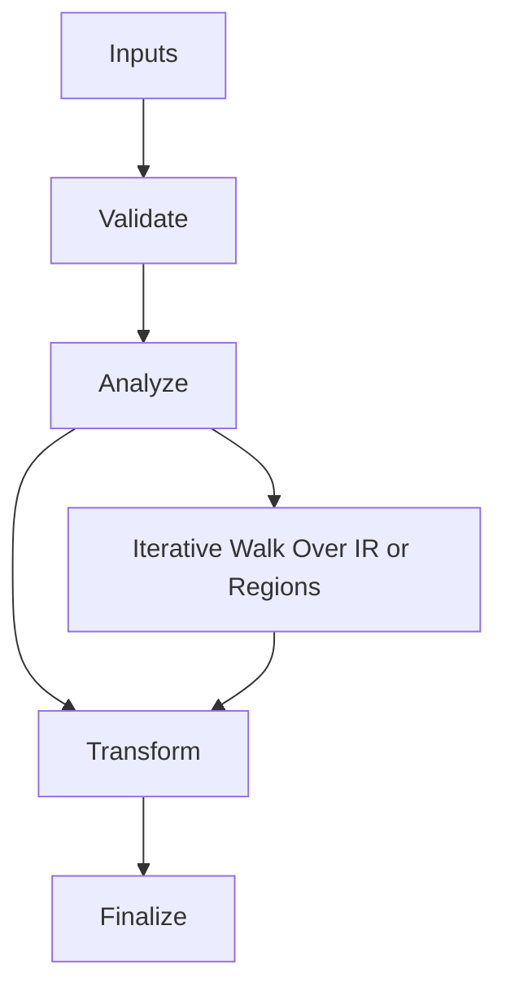

/*
 * Copyright (c) 2026 TataG Systems. All rights reserved.
 *
 * Project:    DGTL (Deep General-purpose Transformation Layer)
 * Owner:      Divyanshu Tata
 * Repository: github.com/TataG-Systems/DGTL
 *
 * This software is the proprietary property of TataG Systems.
 * Unauthorized copying, modification, or distribution is strictly prohibited.
 */

# AI_Cost_Model.hpp

Source Header: include/dgtl/analysis/cost/AI_Cost_Model.hpp
Last Synced: 2026-04-14 19:46:39

## Vision
This component exists to make the compiler/runtime pipeline explicit, safe, and predictable under high-performance constraints.

## Why This File Exists
- Compute signals and invariants used to guide optimization and safe scheduling decisions.
- Keep responsibilities localized so surrounding passes and backends can compose without hidden coupling.
- Preserve correctness with explicit guardrails before optimization gains.
- Predictive scoring is centralized here to make pass selection decisions explainable and stable.
- Sentinel-style integrity checks are intentionally present to detect corruption before commit stages.

## Core Logic
- Inputs are validated early and non-actionable states return fast.
- Main logic operates on typed IR structures and explicit state transitions.
- Traversal is iterative to keep performance linear over stream and region size.
- Structural hashes are refreshed or verified to preserve correctness across rewrites.
- The design favors deterministic transformations and bounded side effects.

## Control Flow Graph and Map

## Control Flow Narrative
- Entry points validate stream and state before any mutation or expensive work.
- Processing is mainly loop-driven to walk nodes, regions, or dependency structures.

## Include Dependencies
- #include <array>
- #include 
- #include <cmath>
- #include <algorithm>
- #include <numeric>
- #include "dgtl/ir/base/Global_IR.hpp"
- #include "dgtl/graph/Region.hpp"

## Class and Struct Catalog
### Classes
- class alignas(64) DGTLAICostModel {
### Structs
- struct RuntimeFeedback {

## Enum Catalog
- none detected

## Function Catalog
- [[nodiscard]] float predict_cost(const ir::IRStream& stream) const noexcept {
- [[nodiscard]] float predict_region_cost(const graph::Region& region) const noexcept {
- [[nodiscard]] float predict_node_cost(const ir::IRNode& node) const noexcept {
- void update_with_feedback(const ir::IRNode& node, const RuntimeFeedback& feedback) {
- [[nodiscard]] float predict_alias_risk(const ir::IRNode& store, const ir::IRNode& load) const noexcept {
- [[nodiscard]] float predict_independence(const ir::IRNode& a, const ir::IRNode& b) const noexcept {
- void preprocess_node(const ir::IRNode& node, float* out) const noexcept {
- float run_micro_inference(const float* input) const noexcept {

## Design Decisions and Whys
- Explicit typing across IR nodes and flags reduces hidden semantic drift.
- Guard checks prevent invalid states from propagating into emitters and runtime paths.
- Layered modules allow policy evolution in pass and pipeline without backend rewrites.

## Critical Invariants
- Intent hash values must be consistent with opcode and operands after mutation.

## Practical Reading Order
- Start with type and enum declarations.
- Follow entry functions for control-flow intent.
- Then inspect helper methods for safety and transformation details.
