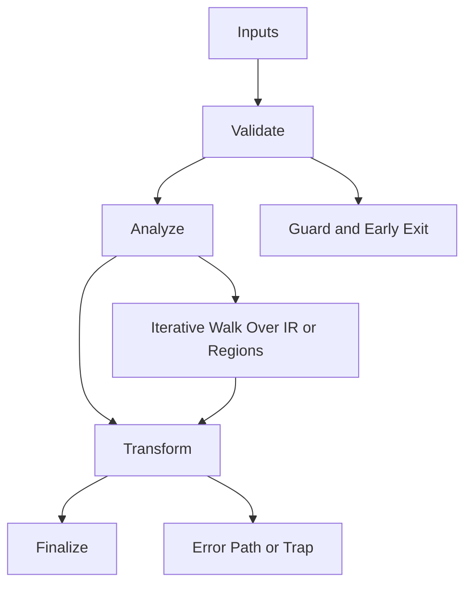

/*
 * Copyright (c) 2026 TataG Systems. All rights reserved.
 *
 * Project:    DGTL (Deep General-purpose Transformation Layer)
 * Owner:      Divyanshu Tata
 * Repository: github.com/TataG-Systems/DGTL
 *
 * This software is the proprietary property of TataG Systems.
 * Unauthorized copying, modification, or distribution is strictly prohibited.
 */

# Liveness_Analyzer.hpp

Source Header: include/dgtl/analysis/dataflow/Liveness_Analyzer.hpp
Last Synced: 2026-04-14 19:46:39

## Vision
This component exists to make the compiler/runtime pipeline explicit, safe, and predictable under high-performance constraints.

## Why This File Exists
- Compute signals and invariants used to guide optimization and safe scheduling decisions.
- Keep responsibilities localized so surrounding passes and backends can compose without hidden coupling.
- Preserve correctness with explicit guardrails before optimization gains.
- This file formalizes live-range truth so downstream passes avoid removing still-required values.
- Sentinel-style integrity checks are intentionally present to detect corruption before commit stages.

## Core Logic
- Inputs are validated early and non-actionable states return fast.
- Main logic operates on typed IR structures and explicit state transitions.
- Traversal is iterative to keep performance linear over stream and region size.
- The design favors deterministic transformations and bounded side effects.
- Defensive error paths are explicit to prevent silent corruption propagation.

## Control Flow Graph and Map

## Control Flow Narrative
- Entry points validate stream and state before any mutation or expensive work.
- Processing is mainly loop-driven to walk nodes, regions, or dependency structures.
- Failure branches escalate with explicit errors or traps when invariants are violated.

## Include Dependencies
- #include <vector>
- #include <cstdint>
- #include <algorithm>
- #include <cstring>
- #include <stdexcept>
- #include <string>
- #include <iostream>
- #include "dgtl/ir/base/Global_IR.hpp"
- #include <malloc.h>
- #include <stdlib.h>

## Class and Struct Catalog
### Classes
- class LivenessAnalyzer {
### Structs
- struct alignas(8) LivenessRange {

## Enum Catalog
- none detected

## Function Catalog
- explicit LivenessAnalyzer(int target_ram_gb = 32) {
- void analyze_stream(const ir::IRStream& stream) {
- [[nodiscard]] bool is_live_at(uint32_t result_id, uint32_t ins_idx) const noexcept {
- void cold_reset() noexcept {
- inline void track_id(uint32_t id) noexcept {
- inline void track_and_mark_use(uint32_t id, uint32_t idx) noexcept {
- void verify_consistency() {

## Design Decisions and Whys
- Explicit typing across IR nodes and flags reduces hidden semantic drift.
- Guard checks prevent invalid states from propagating into emitters and runtime paths.
- Layered modules allow policy evolution in pass and pipeline without backend rewrites.

## Critical Invariants
- Null or invalid sentinel states must be short-circuited early.
- Error paths must fail loudly to avoid silent semantic drift.

## Practical Reading Order
- Start with type and enum declarations.
- Follow entry functions for control-flow intent.
- Then inspect helper methods for safety and transformation details.
