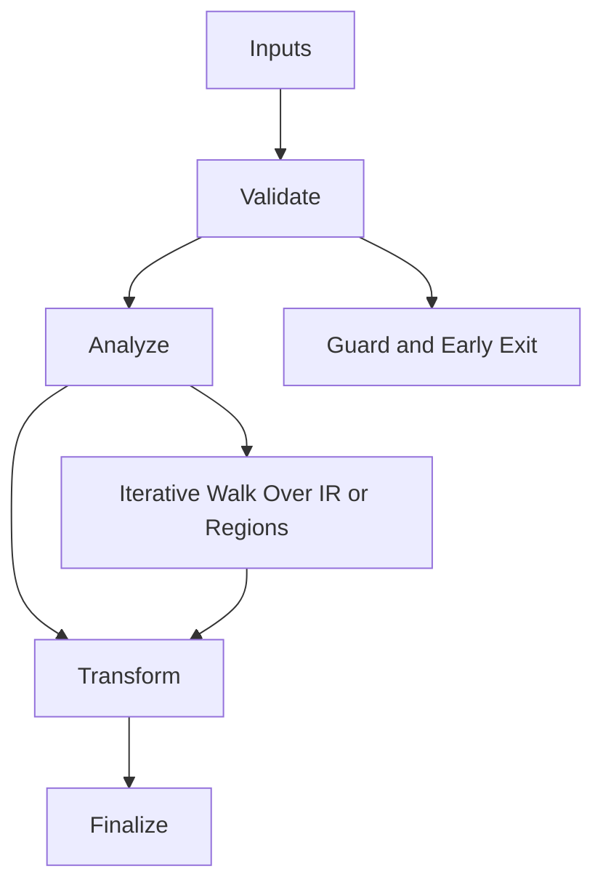

/*
 * Copyright (c) 2026 TataG Systems. All rights reserved.
 *
 * Project:    DGTL (Deep General-purpose Transformation Layer)
 * Owner:      Divyanshu Tata
 * Repository: github.com/TataG-Systems/DGTL
 *
 * This software is the proprietary property of TataG Systems.
 * Unauthorized copying, modification, or distribution is strictly prohibited.
 */

# Memory_Dependency_Smasher.hpp

Source Header: include/dgtl/analysis/dataflow/Memory_Dependency_Smasher.hpp
Last Synced: 2026-04-14 19:46:39

## Vision
This component exists to make the compiler/runtime pipeline explicit, safe, and predictable under high-performance constraints.

## Why This File Exists
- Compute signals and invariants used to guide optimization and safe scheduling decisions.
- Keep responsibilities localized so surrounding passes and backends can compose without hidden coupling.
- Preserve correctness with explicit guardrails before optimization gains.
- Memory dependency logic is isolated to prevent unsafe reorderings in optimization passes.
- Sentinel-style integrity checks are intentionally present to detect corruption before commit stages.

## Core Logic
- Inputs are validated early and non-actionable states return fast.
- Main logic operates on typed IR structures and explicit state transitions.
- Traversal is iterative to keep performance linear over stream and region size.
- The design favors deterministic transformations and bounded side effects.
- Defensive error paths are explicit to prevent silent corruption propagation.

## Control Flow Graph and Map

## Control Flow Narrative
- Entry points validate stream and state before any mutation or expensive work.
- Processing is mainly loop-driven to walk nodes, regions, or dependency structures.

## Include Dependencies
- #include <unordered_map>
- #include <cstdint>
- #include <algorithm>
- #include "dgtl/ir/base/Global_IR.hpp"
- #include "dgtl/core/Verified_Formal.hpp"
- #include "dgtl/analysis/cost/AI_Cost_Model.hpp"

## Class and Struct Catalog
### Classes
- class DGTLMemorySmasher {

## Enum Catalog
- none detected

## Function Catalog
- [[nodiscard]] float predict_alias_probability(const ir::IRStream& stream, uint32_t idx_a, uint32_t idx_b) noexcept {
- [[nodiscard]] bool can_reorder(const ir::IRStream& stream, uint32_t store_idx, uint32_t load_idx) noexcept {
- void begin_provenance_strike() {
- void commit_provenance_strike() {
- void rollback_provenance_strike() {
- void register_ptr_region(uint32_t ptr_id, uint64_t region_id) {
- [[nodiscard]] bool is_guaranteed_invariant(const ir::IRStream& stream, uint32_t load_idx) noexcept {
- [[nodiscard]] bool can_group_access(const ir::IRStream& stream, uint32_t start_idx, uint32_t count) noexcept {
- [[nodiscard]] uint64_t get_region(uint32_t ptr_id) const noexcept {

## Design Decisions and Whys
- Explicit typing across IR nodes and flags reduces hidden semantic drift.
- Guard checks prevent invalid states from propagating into emitters and runtime paths.
- Layered modules allow policy evolution in pass and pipeline without backend rewrites.

## Critical Invariants
- Public operations should preserve deterministic behavior for equivalent inputs.

## Practical Reading Order
- Start with type and enum declarations.
- Follow entry functions for control-flow intent.
- Then inspect helper methods for safety and transformation details.
