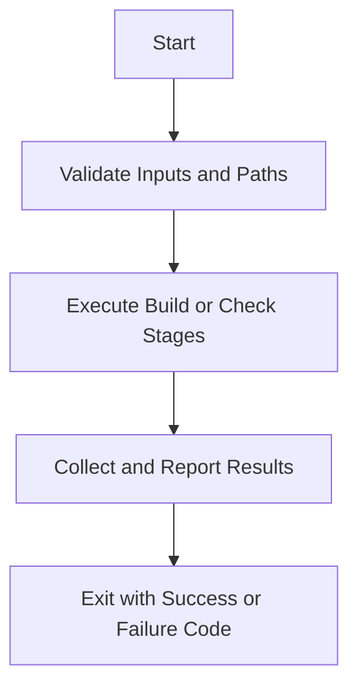

# fast_regression.ps1

Source Script: docs/My_Docs/commands/fast_regression.ps1
Last Synced: 2026-04-14 19:46:42

## Vision
Provide deterministic prelaunch automation with clear pass/fail behavior.

## Why This Script Exists
- One-step compile plus backend conformance gate for rapid regression checks.
- Keep operational behavior deterministic across local and CI runs.
- Make failure causes visible through explicit step boundaries.

## Core Logic
- Resolve execution context and validate required paths.
- Execute ordered verification stages without hidden side effects.
- Aggregate outcome and return explicit process status.

## Control Flow Graph and Map

## Control Flow Narrative
- Script starts with strict preconditions and path checks.
- Main stages execute in deterministic order to avoid flaky behavior.
- Failures exit immediately with non-zero status to stop unsafe release flow.

## Key Logic Snippets
- Source script snippets unavailable; validate script path if this is unexpected.

## Class and Function Catalog
- N/A for script document.

## Design Decisions and Whys
- Uses explicit exit codes to support CI and local prelaunch checks.
- Keeps build and conformance concerns composable and auditable.

## Critical Invariants
- A non-zero stage failure must propagate to non-zero script exit.
- Verification order must remain stable to keep outcomes reproducible.
