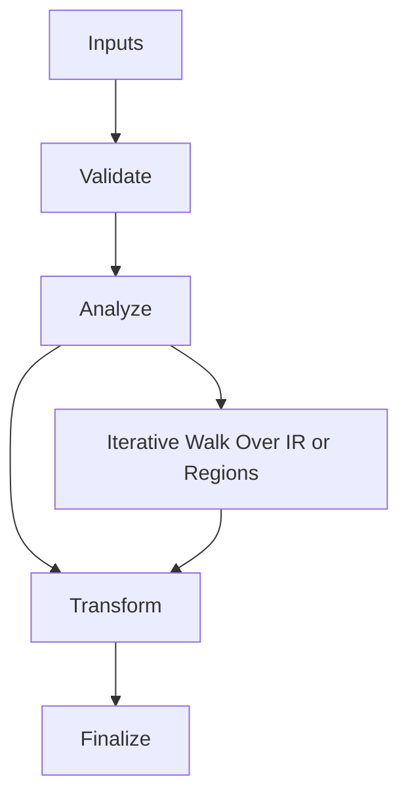

/*
 * Copyright (c) 2026 TataG Systems. All rights reserved.
 *
 * Project:    DGTL (Deep General-purpose Transformation Layer)
 * Owner:      Divyanshu Tata
 * Repository: github.com/TataG-Systems/DGTL
 *
 * This software is the proprietary property of TataG Systems.
 * Unauthorized copying, modification, or distribution is strictly prohibited.
 */

# Arena.hpp

Source Header: include/dgtl/core/Arena.hpp
Last Synced: 2026-04-14 19:46:40

## Vision
This component exists to make the compiler/runtime pipeline explicit, safe, and predictable under high-performance constraints.

## Why This File Exists
- Provide foundational contracts for memory, validation, target behavior, and shared compiler state.
- Keep responsibilities localized so surrounding passes and backends can compose without hidden coupling.
- Preserve correctness with explicit guardrails before optimization gains.
- This file captures a focused subsystem contract so complexity does not leak across module boundaries.

## Core Logic
- Inputs are validated early and non-actionable states return fast.
- Main logic operates on typed IR structures and explicit state transitions.
- Traversal is iterative to keep performance linear over stream and region size.
- The design favors deterministic transformations and bounded side effects.
- Defensive error paths are explicit to prevent silent corruption propagation.

## Control Flow Graph and Map

## Control Flow Narrative
- Entry points validate stream and state before any mutation or expensive work.
- Processing is mainly loop-driven to walk nodes, regions, or dependency structures.

## Include Dependencies
- #include <cstdint>
- #include <cstddef>
- #include <vector>
- #include <thread>
- #include <atomic>
- #include <new>
- #include <type_traits>
- #include <limits>
- #include <windows.h>
- #include <sys/mman.h>

## Class and Struct Catalog
### Classes
- class ThreadLocalArena {
- class DGTL_Arena {
### Structs
- struct ArenaBlock {

## Enum Catalog
- none detected

## Function Catalog
- void init(size_t size_bytes) {
- T* allocate(size_t count = 1) noexcept {
- if constexpr (!std::is_fundamental_v<T>) {
- void push_checkpoint() {
- void rollback() {
- void commit() {
- void reset() {
- ThreadLocalArena& get_local() noexcept {
- return get_local().template allocate<T>(count);
- void begin() {
- void reset_all() {

## Design Decisions and Whys
- Explicit typing across IR nodes and flags reduces hidden semantic drift.
- Guard checks prevent invalid states from propagating into emitters and runtime paths.
- Layered modules allow policy evolution in pass and pipeline without backend rewrites.

## Critical Invariants
- Public operations should preserve deterministic behavior for equivalent inputs.

## Practical Reading Order
- Start with type and enum declarations.
- Follow entry functions for control-flow intent.
- Then inspect helper methods for safety and transformation details.
