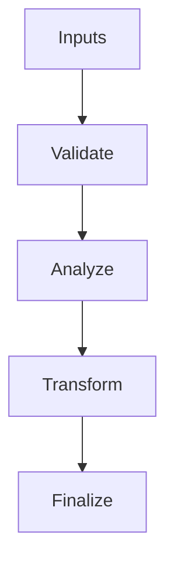

/*
 * Copyright (c) 2026 TataG Systems. All rights reserved.
 *
 * Project:    DGTL (Deep General-purpose Transformation Layer)
 * Owner:      Divyanshu Tata
 * Repository: github.com/TataG-Systems/DGTL
 *
 * This software is the proprietary property of TataG Systems.
 * Unauthorized copying, modification, or distribution is strictly prohibited.
 */

# Global_IR.hpp

Source Header: include/dgtl/ir/base/Global_IR.hpp
Last Synced: 2026-04-14 19:46:40

## Vision
This component exists to make the compiler/runtime pipeline explicit, safe, and predictable under high-performance constraints.

## Why This File Exists
- Represent program semantics in compact, verifiable IR forms suitable for transformation and emission.
- Keep responsibilities localized so surrounding passes and backends can compose without hidden coupling.
- Preserve correctness with explicit guardrails before optimization gains.
- This file captures a focused subsystem contract so complexity does not leak across module boundaries.

## Core Logic
- Inputs are validated early and non-actionable states return fast.
- Main logic operates on typed IR structures and explicit state transitions.
- The design favors deterministic transformations and bounded side effects.

## Control Flow Graph and Map

## Control Flow Narrative
- Entry points validate stream and state before any mutation or expensive work.

## Include Dependencies
- #include "IR_Types.hpp"       // Enum OpCode, struct Flags, struct IRTraits
- #include "IR_Nodes.hpp"       // Unified IRNode architecture
- #include "IR_Traits.hpp"      // SFINAE/Concepts for IR validity
- #include "../dialect/IR_Dialect_Interface.hpp" // Rules for AI, HFT, and Custom Dialects
- #include "IR_Storage.hpp"     // Arena-backed storage logic
- #include "IR_Stream.hpp"      // The IRStream class and utilities

## Class and Struct Catalog
- none detected

## Enum Catalog
- none detected

## Function Catalog
- none detected

## Design Decisions and Whys
- Explicit typing across IR nodes and flags reduces hidden semantic drift.
- Guard checks prevent invalid states from propagating into emitters and runtime paths.
- Layered modules allow policy evolution in pass and pipeline without backend rewrites.

## Critical Invariants
- Public operations should preserve deterministic behavior for equivalent inputs.

## Practical Reading Order
- Start with type and enum declarations.
- Follow entry functions for control-flow intent.
- Then inspect helper methods for safety and transformation details.
