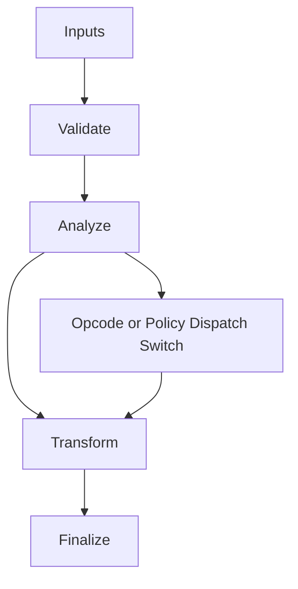

/*
 * Copyright (c) 2026 TataG Systems. All rights reserved.
 *
 * Project:    DGTL (Deep General-purpose Transformation Layer)
 * Owner:      Divyanshu Tata
 * Repository: github.com/TataG-Systems/DGTL
 *
 * This software is the proprietary property of TataG Systems.
 * Unauthorized copying, modification, or distribution is strictly prohibited.
 */

# IR_Nodes.hpp

Source Header: include/dgtl/ir/base/IR_Nodes.hpp
Last Synced: 2026-04-14 19:46:40

## Vision
This component exists to make the compiler/runtime pipeline explicit, safe, and predictable under high-performance constraints.

## Why This File Exists
- Represent program semantics in compact, verifiable IR forms suitable for transformation and emission.
- Keep responsibilities localized so surrounding passes and backends can compose without hidden coupling.
- Preserve correctness with explicit guardrails before optimization gains.
- IR contracts here define semantic invariants every pass and emitter relies on.
- Sentinel-style integrity checks are intentionally present to detect corruption before commit stages.

## Core Logic
- Inputs are validated early and non-actionable states return fast.
- Main logic operates on typed IR structures and explicit state transitions.
- Dispatch logic uses explicit switching to keep opcode or policy behavior transparent.
- Structural hashes are refreshed or verified to preserve correctness across rewrites.
- The design favors deterministic transformations and bounded side effects.

## Control Flow Graph and Map

## Control Flow Narrative
- Entry points validate stream and state before any mutation or expensive work.
- Dispatch branches by opcode or strategy to keep behavior explicit and testable.

## Include Dependencies
- #include "IR_Types.hpp"
- #include "IR_Traits.hpp"
- #include <type_traits>

## Class and Struct Catalog
### Structs
- struct alignas(32) IRNode {

## Enum Catalog
- none detected

## Function Catalog
- [[nodiscard]] constexpr bool is_terminator() const noexcept {
- [[nodiscard]] inline bool is_volatile() const noexcept {
- [[nodiscard]] inline bool has_side_effects() const noexcept {
- [[nodiscard]] inline bool is_valid() const noexcept {
- [[nodiscard]] inline uint64_t logic_hash() const noexcept {
- [[nodiscard]] inline double predict_inlined_benefit() const noexcept {
- static constexpr uint64_t calculate_hash(OpCode op, uint32_t res, uint32_t a, uint32_t b, uint32_t c) noexcept {
- inline void refresh_intent_hash() noexcept {
- inline void fold_if_possible() noexcept {

## Design Decisions and Whys
- Explicit typing across IR nodes and flags reduces hidden semantic drift.
- Guard checks prevent invalid states from propagating into emitters and runtime paths.
- Layered modules allow policy evolution in pass and pipeline without backend rewrites.

## Critical Invariants
- Intent hash values must be consistent with opcode and operands after mutation.

## Practical Reading Order
- Start with type and enum declarations.
- Follow entry functions for control-flow intent.
- Then inspect helper methods for safety and transformation details.
