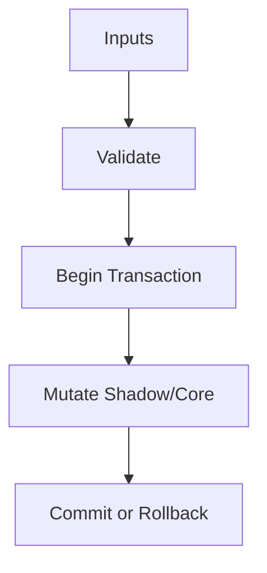

/*
 * Copyright (c) 2026 TataG Systems. All rights reserved.
 *
 * Project:    DGTL (Deep General-purpose Transformation Layer)
 * Owner:      Divyanshu Tata
 * Repository: github.com/TataG-Systems/DGTL
 *
 * This software is the proprietary property of TataG Systems.
 * Unauthorized copying, modification, or distribution is strictly prohibited.
 */

# IR_Storage.hpp

Source Header: include/dgtl/ir/base/IR_Storage.hpp
Last Synced: 2026-04-14 19:46:40

## Vision
This component exists to make the compiler/runtime pipeline explicit, safe, and predictable under high-performance constraints.

## Why This File Exists
- Represent program semantics in compact, verifiable IR forms suitable for transformation and emission.
- Keep responsibilities localized so surrounding passes and backends can compose without hidden coupling.
- Preserve correctness with explicit guardrails before optimization gains.
- This file captures a focused subsystem contract so complexity does not leak across module boundaries.

## Core Logic
- Inputs are validated early and non-actionable states return fast.
- Main logic operates on typed IR structures and explicit state transitions.
- Transactional semantics are present: begin, mutate, validate, then commit or rollback.

## Control Flow Graph and Map

## Control Flow Narrative
- Entry points validate stream and state before any mutation or expensive work.
- Mutation paths are transactional to ensure safe rollback on validation failure.

## Include Dependencies
- #include <cstdint>
- #include <cstddef>
- #include <cstring>
- #include <atomic>
- #include <cstdlib>   // aligned_alloc / free / _aligned_malloc
- #include "dgtl/core/Arena.hpp"
- #include "IR_Types.hpp"
- #include "IR_Nodes.hpp"
- #include "IR_Traits.hpp"

## Class and Struct Catalog
### Structs
- struct IRStorage {

## Enum Catalog
- none detected

## Function Catalog
- void deallocate() {
- inline void commit_transaction() noexcept {

## Design Decisions and Whys
- Explicit typing across IR nodes and flags reduces hidden semantic drift.
- Guard checks prevent invalid states from propagating into emitters and runtime paths.
- Layered modules allow policy evolution in pass and pipeline without backend rewrites.

## Critical Invariants
- Transaction boundaries must remain balanced across success and failure paths.

## Practical Reading Order
- Start with type and enum declarations.
- Follow entry functions for control-flow intent.
- Then inspect helper methods for safety and transformation details.
