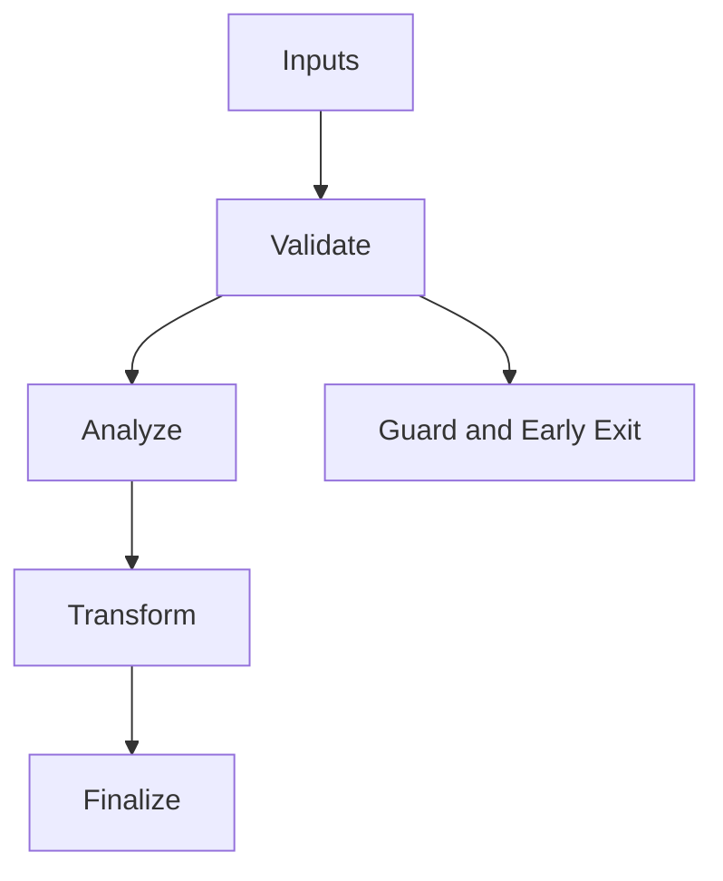

/*
 * Copyright (c) 2026 TataG Systems. All rights reserved.
 *
 * Project:    DGTL (Deep General-purpose Transformation Layer)
 * Owner:      Divyanshu Tata
 * Repository: github.com/TataG-Systems/DGTL
 *
 * This software is the proprietary property of TataG Systems.
 * Unauthorized copying, modification, or distribution is strictly prohibited.
 */

# IR_Dialect_Interface.hpp

Source Header: include/dgtl/ir/dialect/IR_Dialect_Interface.hpp
Last Synced: 2026-04-14 19:46:40

## Vision
This component exists to make the compiler/runtime pipeline explicit, safe, and predictable under high-performance constraints.

## Why This File Exists
- Represent program semantics in compact, verifiable IR forms suitable for transformation and emission.
- Keep responsibilities localized so surrounding passes and backends can compose without hidden coupling.
- Preserve correctness with explicit guardrails before optimization gains.
- IR contracts here define semantic invariants every pass and emitter relies on.
- Sentinel-style integrity checks are intentionally present to detect corruption before commit stages.

## Core Logic
- Inputs are validated early and non-actionable states return fast.
- Main logic operates on typed IR structures and explicit state transitions.
- Structural hashes are refreshed or verified to preserve correctness across rewrites.
- The design favors deterministic transformations and bounded side effects.

## Control Flow Graph and Map

## Control Flow Narrative
- Entry points validate stream and state before any mutation or expensive work.

## Include Dependencies
- #include <concepts>
- #include <string_view>
- #include <type_traits>
- #include <array>
- #include "../base/IR_Nodes.hpp"

## Class and Struct Catalog
### Classes
- class IRStream;
- class OpRegistry {
### Structs
- struct BaseOp {
- struct MathDialect {
- struct FastAdd : BaseOp<FastAdd, static_cast<ir::OpCode>(0x8001)> {
- struct FastFMA : BaseOp<FastFMA, static_cast<ir::OpCode>(0x8002)> {

## Enum Catalog
- none detected

## Function Catalog
- [[nodiscard]] static inline bool verify(const ir::IRAtom& atom, const ir::IRCore& core) noexcept {
- [[nodiscard]] static inline bool verify_impl([[maybe_unused]] const ir::IRAtom& atom, const ir::IRCore& core) noexcept {
- [[nodiscard]] static bool verify_stream(ir::IRStream& stream) noexcept;
- static void evolve_stream(ir::IRStream& stream) noexcept;
- [[nodiscard]] static inline bool dispatch_verify(const ir::IRAtom& atom, const ir::IRCore& core) noexcept {

## Design Decisions and Whys
- Explicit typing across IR nodes and flags reduces hidden semantic drift.
- Guard checks prevent invalid states from propagating into emitters and runtime paths.
- Layered modules allow policy evolution in pass and pipeline without backend rewrites.

## Critical Invariants
- Intent hash values must be consistent with opcode and operands after mutation.

## Practical Reading Order
- Start with type and enum declarations.
- Follow entry functions for control-flow intent.
- Then inspect helper methods for safety and transformation details.
