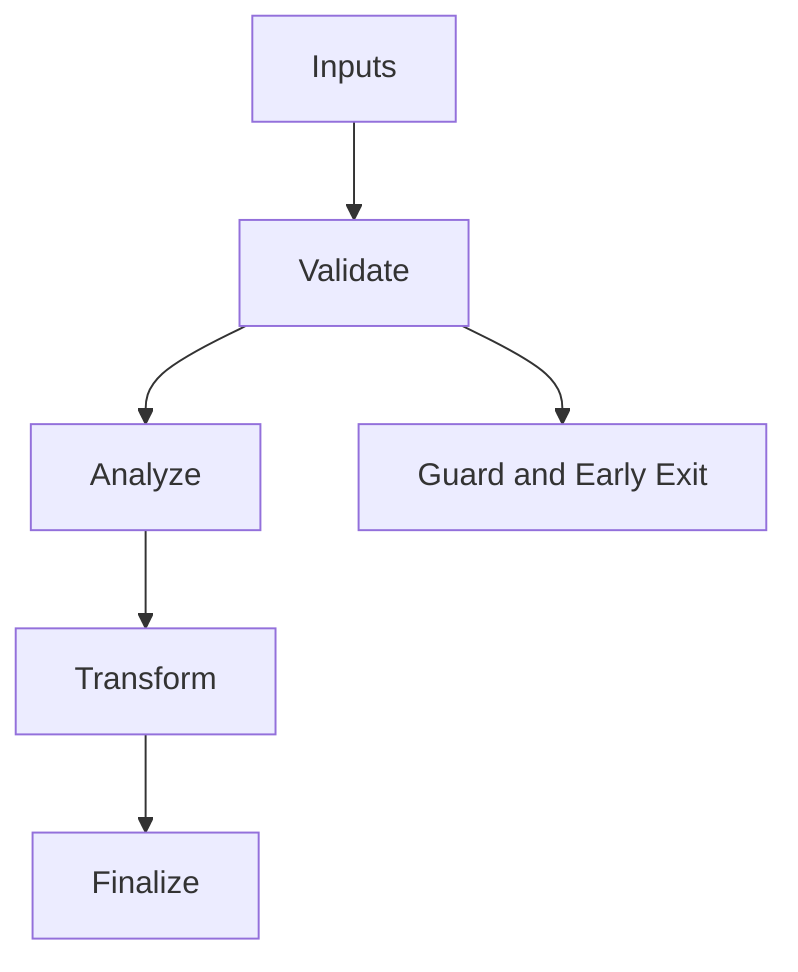

/*
 * Copyright (c) 2026 TataG Systems. All rights reserved.
 *
 * Project:    DGTL (Deep General-purpose Transformation Layer)
 * Owner:      Divyanshu Tata
 * Repository: github.com/TataG-Systems/DGTL
 *
 * This software is the proprietary property of TataG Systems.
 * Unauthorized copying, modification, or distribution is strictly prohibited.
 */

# MachO_Emitter.hpp

Source Header: include/dgtl/isa/emitter/MachO_Emitter.hpp
Last Synced: 2026-04-20

## Vision
Complete Mach-O 64-bit ARM64 object file emitter. Generates structurally valid MH_OBJECT files with real ARM64 binary instruction encoding from DGTL IR.

## Why This File Exists
- Emit Mach-O 64-bit ARM64 object files (`.o` / `.macho`) from IR streams.
- Generate real ARM64 binary machine code (12 opcode types: ADD/SUB/MUL/AND/OR/XOR/MOV/MOVZ/LDR/STR/RET/NOP).
- Build complete Mach-O structure with `mach_header_64`, `LC_SEGMENT_64` (containing `__TEXT,__text`), and `LC_SYMTAB` load commands.
- Backend lowering is explicit here to keep architecture behavior auditable and deterministic.

## Core Logic
- Inputs are validated early and non-actionable states return fast.
- Main logic operates on typed IR structures and explicit state transitions.
- The design favors deterministic transformations and bounded side effects.

## Control Flow Graph and Map

## Control Flow Narrative
- Entry points validate stream and state before any mutation or expensive work.

## Include Dependencies
- #include <vector>
- #include <string>
- #include <fstream>
- #include <cstring>
- #include "dgtl/ir/base/Global_IR.hpp"
- #include "dgtl/isa/emitter/ARM64_Emitter.hpp"

## Class and Struct Catalog
### Classes
- class alignas(64) MachOEmitter { — Main emitter class, takes IRStream + SymbolTable
### Structs (in `dgtl::isa::macho` namespace, all `#pragma pack(push, 1)`)
- struct Header64 { — mach_header_64 (magic/cputype/cpusubtype/filetype/ncmds/sizeofcmds/flags/reserved)
- struct SegmentCommand64 { — LC_SEGMENT_64 (cmd/cmdsize/segname/vmaddr/vmsize/fileoff/filesize/maxprot/initprot/nsects/flags)
- struct Section64 { — __TEXT,__text section (sectname/segname/addr/size/offset/align/reloff/nreloc/flags/reserved1/2/3)
- struct SymtabCommand { — LC_SYMTAB (cmd/cmdsize/symoff/nsyms/stroff/strsize)
- struct Nlist64 { — nlist_64 symbol entry (n_strx/n_type/n_sect/n_desc/n_value)
- struct MachOResult { — Emission result (success/binary_data)

## Enum Catalog
- none detected

## Function Catalog
- MachOResult emit_to_binary() { — Build complete Mach-O binary (header + LC_SEGMENT_64 + LC_SYMTAB + .text + symtab + strtab)
- bool save_to_file(const std::string& filename) { — File-writing wrapper
- std::vector<uint8_t> generate_arm64_binary() { — Encode IR nodes to real ARM64 instructions (ADD/SUB/MUL/AND/OR/XOR/MOV/MOVZ/LDR/STR/RET/NOP)
- static uint32_t encode_arm64_instruction(const ir::IRNode& node) { — Maps IR opcodes to ARM64 binary encodings

## Design Decisions and Whys
- Explicit typing across IR nodes and flags reduces hidden semantic drift.
- Guard checks prevent invalid states from propagating into emitters and runtime paths.
- Layered modules allow policy evolution in pass and pipeline without backend rewrites.

## Critical Invariants
- Null or invalid sentinel states must be short-circuited early.

## Practical Reading Order
- Start with type and enum declarations.
- Follow entry functions for control-flow intent.
- Then inspect helper methods for safety and transformation details.
