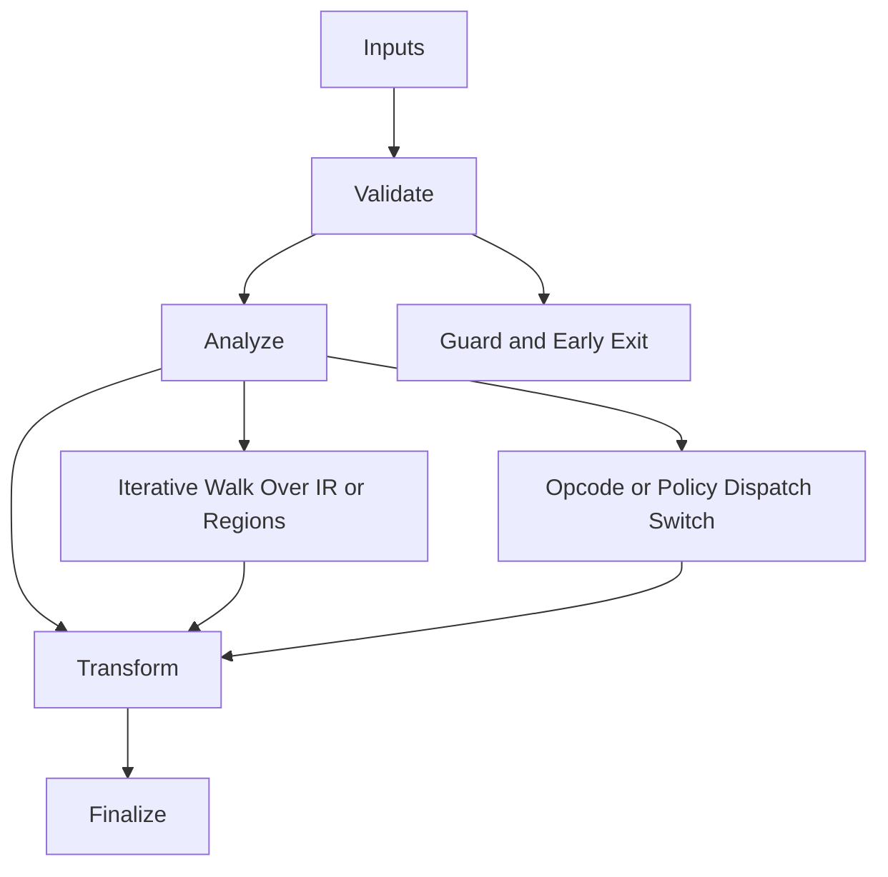

/*
 * Copyright (c) 2026 TataG Systems. All rights reserved.
 *
 * Project:    DGTL (Deep General-purpose Transformation Layer)
 * Owner:      Divyanshu Tata
 * Repository: github.com/TataG-Systems/DGTL
 *
 * This software is the proprietary property of TataG Systems.
 * Unauthorized copying, modification, or distribution is strictly prohibited.
 */

# X64_Strike_Emitter.hpp

Source Header: include/dgtl/isa/emitter/X64_Strike_Emitter.hpp
Last Synced: 2026-04-14 19:46:41

## Vision
This component exists to make the compiler/runtime pipeline explicit, safe, and predictable under high-performance constraints.

## Why This File Exists
- Lower IR into target-specific representation while preserving semantic correctness and backend constraints.
- Keep responsibilities localized so surrounding passes and backends can compose without hidden coupling.
- Preserve correctness with explicit guardrails before optimization gains.
- Backend lowering is explicit here to keep architecture behavior auditable and deterministic.
- Sentinel-style integrity checks are intentionally present to detect corruption before commit stages.

## Core Logic
- Inputs are validated early and non-actionable states return fast.
- Main logic operates on typed IR structures and explicit state transitions.
- Traversal is iterative to keep performance linear over stream and region size.
- Dispatch logic uses explicit switching to keep opcode or policy behavior transparent.
- Structural hashes are refreshed or verified to preserve correctness across rewrites.
- The design favors deterministic transformations and bounded side effects.

## Control Flow Graph and Map

## Control Flow Narrative
- Entry points validate stream and state before any mutation or expensive work.
- Processing is mainly loop-driven to walk nodes, regions, or dependency structures.
- Dispatch branches by opcode or strategy to keep behavior explicit and testable.

## Include Dependencies
- #include <vector>
- #include <cstdint>
- #include <cstring>
- #include <iostream>
- #include <string_view>
- #include "dgtl/ir/base/Global_IR.hpp"
- #include "dgtl/isa/regalloc/X64_Reg_Map.hpp"

## Class and Struct Catalog
### Classes
- class X64StrikeEmitter {

## Enum Catalog
- none detected

## Function Catalog
- void process_stream(const ir::IRStream& stream, ByteStream& out) {
- void emit_node(const ir::IRNode& node, ByteStream& out) {
- void emit_unhandled(const ir::IRNode& node, ByteStream& out) {
- void emit_gather_512(const ir::IRNode& node, ByteStream& out) {
- void emit_mov_reg(const ir::IRNode& node, ByteStream& out) {
- void emit_add_i32(const ir::IRNode& node, ByteStream& out) {
- void emit_sub_i32(const ir::IRNode& node, ByteStream& out) {
- void emit_mul_i32(const ir::IRNode& node, ByteStream& out) {
- void emit_and_i32(const ir::IRNode& node, ByteStream& out) {
- void emit_or_i32(const ir::IRNode& node, ByteStream& out) {
- void emit_xor_i32(const ir::IRNode& node, ByteStream& out) {
- void emit_shl_i32(const ir::IRNode& node, ByteStream& out) {
- void emit_mov_imm64(const ir::IRNode& node, ByteStream& out) {
- void emit_load_stack(const ir::IRNode& node, ByteStream& out) {
- void emit_store_stack(const ir::IRNode& node, ByteStream& out) {
- void emit_store_v512(const ir::IRNode& node, ByteStream& out) {
- void emit_vec_add_f32_512(const ir::IRNode& node, ByteStream& out) {
- void emit_vec_mul_f32_512(const ir::IRNode& node, ByteStream& out) {
- bool fuse_across_nodes(std::vector<ir::IRNode*>& nodes) {

## Design Decisions and Whys
- Explicit typing across IR nodes and flags reduces hidden semantic drift.
- Guard checks prevent invalid states from propagating into emitters and runtime paths.
- Layered modules allow policy evolution in pass and pipeline without backend rewrites.

## Critical Invariants
- Intent hash values must be consistent with opcode and operands after mutation.
- Null or invalid sentinel states must be short-circuited early.

## Practical Reading Order
- Start with type and enum declarations.
- Follow entry functions for control-flow intent.
- Then inspect helper methods for safety and transformation details.
