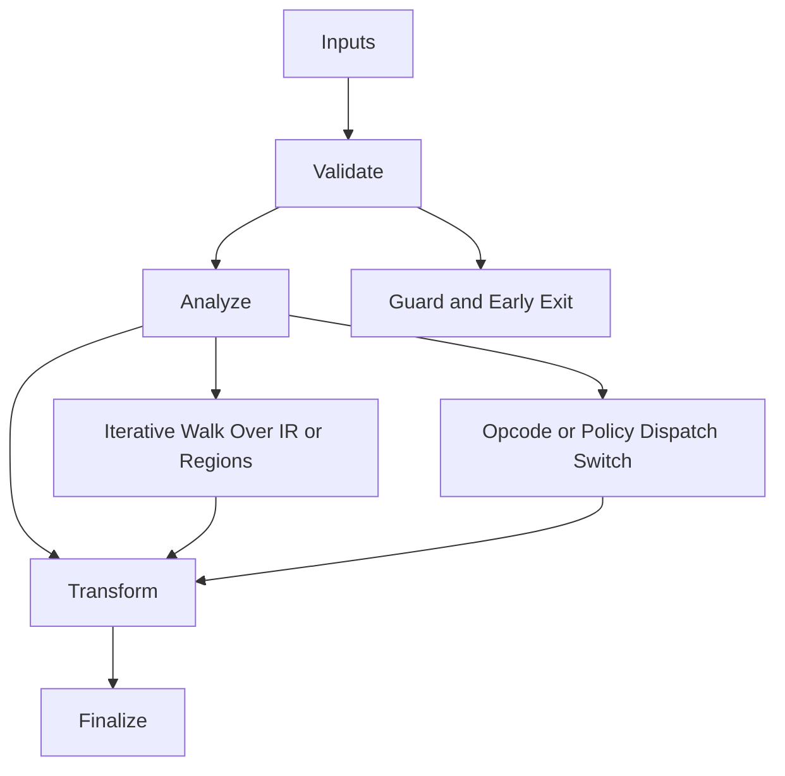

/*
 * Copyright (c) 2026 TataG Systems. All rights reserved.
 *
 * Project:    DGTL (Deep General-purpose Transformation Layer)
 * Owner:      Divyanshu Tata
 * Repository: github.com/TataG-Systems/DGTL
 *
 * This software is the proprietary property of TataG Systems.
 * Unauthorized copying, modification, or distribution is strictly prohibited.
 */

# Linker_Backend.hpp

Source Header: include/dgtl/isa/linker/Linker_Backend.hpp
Last Synced: 2026-04-20

## Vision
Universal binary format emission engine. Produces native object files and static archives for all major platforms from DGTL IR, enabling DGTL-compiled code to link with standard system toolchains.

## Why This File Exists
- Emit ELF64 relocatable objects (`.o`) with full section header table, symbol table, string tables, and `.rela.text` relocations — consumable by `ld`, `gcc`, `clang`.
- Emit GNU `ar` static archives (`.a`) wrapping DGTL-generated ELF objects.
- Emit COFF relocatable objects (`.obj`, `IMAGE_FILE_MACHINE_AMD64`) with file header, section header, symbol table, and string table — consumable by MSVC `link.exe` and MinGW `ld`.
- Emit COFF archives (`.lib`) with first linker member (big-endian symbol index) — consumable by MSVC `link.exe`.
- Keep binary format concerns isolated from ISA emission, pass management, and JIT execution.

## Core Logic
- Inputs are validated early and non-actionable states return fast.
- Main logic operates on typed IR structures and explicit state transitions.
- Traversal is iterative to keep performance linear over stream and region size.
- Dispatch logic uses explicit switching to keep opcode or policy behavior transparent.
- The design favors deterministic transformations and bounded side effects.

## Control Flow Graph and Map

## Control Flow Narrative
- Entry points validate stream and state before any mutation or expensive work.
- Processing is mainly loop-driven to walk nodes, regions, or dependency structures.
- Dispatch branches by opcode or strategy to keep behavior explicit and testable.

## Include Dependencies
- #include <fcntl.h>
- #include <sys/types.h>
- #include <sys/stat.h>
- #include <vector>
- #include <string_view>
- #include <cstring>
- #include <cstdint>
- #include <iostream>
- #include <windows.h>
- #include <io.h>
- #include <sys/mman.h>
- #include <unistd.h>
- #include <elf.h>
- #include "dgtl/ir/base/Global_IR.hpp"

## Class and Struct Catalog
### Classes
- class DGTLLinker {
- class DGTLUniversalLinker : public DGTLLinker {
### Structs
- struct Elf64_Ehdr { — ELF64 file header (16-byte e_ident + type/machine/entry/offsets)
- struct Elf64_Phdr { — ELF64 program header (type/flags/offset/vaddr/paddr/filesz/memsz/align)
- struct Elf64_Shdr { — ELF64 section header (name/type/flags/addr/offset/size/link/info/align/entsize)
- struct Elf64_Sym { — ELF64 symbol table entry (name/info/other/shndx/value/size)
- struct Elf64_Rela { — ELF64 relocation with addend (offset/info/addend)
### COFF Namespace (`dgtl::exec::coff`)
- struct FileHeader { — COFF file header (machine/numberOfSections/timeDateStamp/pointerToSymbolTable/numberOfSymbols/sizeOfOptionalHeader/characteristics)
- struct SectionHeader { — COFF section header (name[8]/virtualSize/virtualAddress/sizeOfRawData/pointerToRawData/pointerToRelocations/pointerToLinenumbers/numberOfRelocations/numberOfLinenumbers/characteristics)
- struct Symbol { — COFF symbol table entry (name[8]/value/sectionNumber/type/storageClass/numberOfAuxSymbols)

## Enum Catalog
- ELF constants: ET_REL, EM_X86_64, SHT_PROGBITS, SHT_SYMTAB, SHT_STRTAB, SHT_RELA, SHF_ALLOC, SHF_EXECINSTR, SHF_INFO_LINK, STB_GLOBAL, STB_LOCAL, STT_FUNC, STT_SECTION
- COFF constants: IMAGE_FILE_MACHINE_AMD64 (0x8664), IMAGE_SCN_CNT_CODE, IMAGE_SCN_MEM_EXECUTE, IMAGE_SCN_MEM_READ, IMAGE_SYM_CLASS_EXTERNAL, IMAGE_SYM_CLASS_STATIC

## Function Catalog
- inline void write_leb128(std::vector<uint8_t>& buf, uint64_t value) { — LEB128 encoding for WASM
- void emit_elf64(std::string_view path, const ir::IRStream& ir_stream) { — Legacy ELF64 ET_EXEC standalone binary
- void emit_machine_code(uint8_t* dest, const ir::IRStream& stream) { — Raw machine code generation
- void emit_wasm(std::string_view path, const ir::IRStream& stream) { — WASM module emission
- bool build_elf_relocatable(std::vector<uint8_t>& out, const ir::IRStream& stream, const char* symbol_name) { — ELF64 ET_REL with 6 sections (NULL, .text, .shstrtab, .strtab, .symtab, .rela.text)
- bool emit_elf_relocatable(std::string_view path, const ir::IRStream& stream, const char* symbol_name) { — File-writing wrapper for ELF .o
- bool build_static_archive(std::vector<uint8_t>& out, const ir::IRStream& stream, const char* member_name) { — GNU ar archive wrapping ELF .o
- bool emit_static_archive(std::string_view path, const ir::IRStream& stream, const char* member_name) { — File-writing wrapper for .a
- bool build_coff_relocatable(std::vector<uint8_t>& out, const ir::IRStream& stream, const char* symbol_name) { — COFF .obj (IMAGE_FILE_MACHINE_AMD64)
- bool emit_coff_relocatable(std::string_view path, const ir::IRStream& stream, const char* symbol_name) { — File-writing wrapper for .obj
- bool build_coff_archive(std::vector<uint8_t>& out, const ir::IRStream& stream, const char* member_name, const char* symbol_name) { — COFF .lib with first linker member
- bool emit_coff_archive(std::string_view path, const ir::IRStream& stream, const char* member_name, const char* symbol_name) { — File-writing wrapper for .lib
- static uint32_t to_big_endian_u32(uint32_t val) { — Helper for COFF first linker member (big-endian symbol offsets)

## Design Decisions and Whys
- Explicit typing across IR nodes and flags reduces hidden semantic drift.
- Guard checks prevent invalid states from propagating into emitters and runtime paths.
- Layered modules allow policy evolution in pass and pipeline without backend rewrites.

## Critical Invariants
- Null or invalid sentinel states must be short-circuited early.

## Practical Reading Order
- Start with type and enum declarations.
- Follow entry functions for control-flow intent.
- Then inspect helper methods for safety and transformation details.
