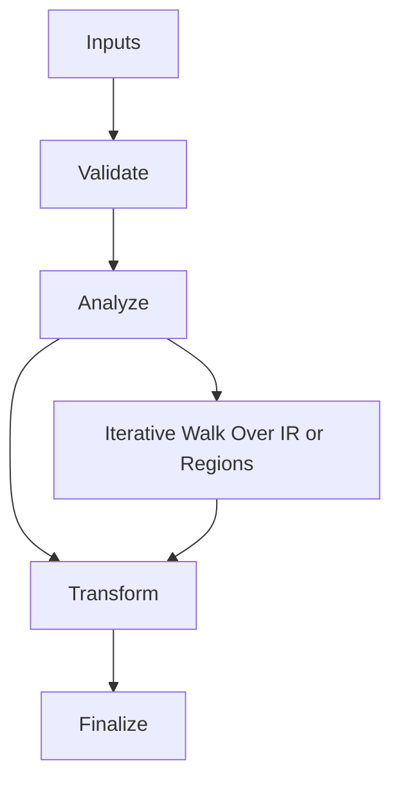

/*
 * Copyright (c) 2026 TataG Systems. All rights reserved.
 *
 * Project:    DGTL (Deep General-purpose Transformation Layer)
 * Owner:      Divyanshu Tata
 * Repository: github.com/TataG-Systems/DGTL
 *
 * This software is the proprietary property of TataG Systems.
 * Unauthorized copying, modification, or distribution is strictly prohibited.
 */

# Stack_Spiller.hpp

Source Header: include/dgtl/isa/lowering/Stack_Spiller.hpp
Last Synced: 2026-04-14 19:46:41

## Vision
This component exists to make the compiler/runtime pipeline explicit, safe, and predictable under high-performance constraints.

## Why This File Exists
- Lower IR into target-specific representation while preserving semantic correctness and backend constraints.
- Keep responsibilities localized so surrounding passes and backends can compose without hidden coupling.
- Preserve correctness with explicit guardrails before optimization gains.
- Backend lowering is explicit here to keep architecture behavior auditable and deterministic.

## Core Logic
- Inputs are validated early and non-actionable states return fast.
- Main logic operates on typed IR structures and explicit state transitions.
- Traversal is iterative to keep performance linear over stream and region size.
- The design favors deterministic transformations and bounded side effects.

## Control Flow Graph and Map

## Control Flow Narrative
- Entry points validate stream and state before any mutation or expensive work.
- Processing is mainly loop-driven to walk nodes, regions, or dependency structures.

## Include Dependencies
- #include <cstdint>
- #include <vector>
- #include <string_view>
- #include <optional>
- #include <unordered_map>
- #include "dgtl/ir/base/Global_IR.hpp"
- #include "dgtl/core/Arena.hpp"

## Class and Struct Catalog
### Classes
- class alignas(64) StackPiller {
### Structs
- struct alignas(16) StackSlot {

## Enum Catalog
- none detected

## Function Catalog
- void push_scope() {
- void pop_scope() {
- int32_t allocate(std::string_view name, uint32_t bytes, OpCode type = OpCode::NOP) {
- [[nodiscard]] std::optional<StackSlot> resolve(std::string_view name) const noexcept {
- [[nodiscard]] uint32_t current_frame_size() const noexcept {
- [[nodiscard]] size_t nesting_depth() const noexcept {
- void reset_frame() {
- [[nodiscard]] static constexpr uint64_t hash_name(std::string_view name) noexcept {

## Design Decisions and Whys
- Explicit typing across IR nodes and flags reduces hidden semantic drift.
- Guard checks prevent invalid states from propagating into emitters and runtime paths.
- Layered modules allow policy evolution in pass and pipeline without backend rewrites.

## Critical Invariants
- Public operations should preserve deterministic behavior for equivalent inputs.

## Practical Reading Order
- Start with type and enum declarations.
- Follow entry functions for control-flow intent.
- Then inspect helper methods for safety and transformation details.
