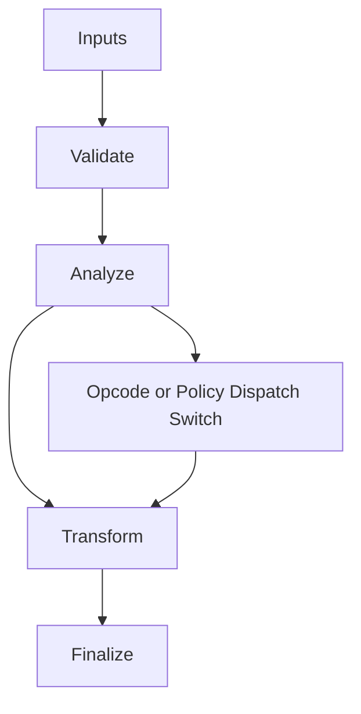

/*
 * Copyright (c) 2026 TataG Systems. All rights reserved.
 *
 * Project:    DGTL (Deep General-purpose Transformation Layer)
 * Owner:      Divyanshu Tata
 * Repository: github.com/TataG-Systems/DGTL
 *
 * This software is the proprietary property of TataG Systems.
 * Unauthorized copying, modification, or distribution is strictly prohibited.
 */

# X64_Reg_Map.hpp

Source Header: include/dgtl/isa/regalloc/X64_Reg_Map.hpp
Last Synced: 2026-04-14 19:46:41

## Vision
This component exists to make the compiler/runtime pipeline explicit, safe, and predictable under high-performance constraints.

## Why This File Exists
- Provide reusable infrastructure used by the DGTL compilation and execution pipeline.
- Keep responsibilities localized so surrounding passes and backends can compose without hidden coupling.
- Preserve correctness with explicit guardrails before optimization gains.
- Backend lowering is explicit here to keep architecture behavior auditable and deterministic.

## Core Logic
- Inputs are validated early and non-actionable states return fast.
- Main logic operates on typed IR structures and explicit state transitions.
- Dispatch logic uses explicit switching to keep opcode or policy behavior transparent.
- The design favors deterministic transformations and bounded side effects.

## Control Flow Graph and Map

## Control Flow Narrative
- Entry points validate stream and state before any mutation or expensive work.
- Dispatch branches by opcode or strategy to keep behavior explicit and testable.

## Include Dependencies
- #include <cstdint>

## Class and Struct Catalog
### Classes
- class X64Encoding {

## Enum Catalog
- enum class X64Reg : uint8_t {

## Function Catalog
- static constexpr inline uint8_t rex(bool w, uint8_t r, uint8_t x, uint8_t b) noexcept {
- static constexpr inline uint8_t modrm(uint8_t mod, uint8_t reg, uint8_t rm) noexcept {
- static constexpr inline uint8_t sib(uint8_t ss, uint8_t index, uint8_t base) noexcept {
- static constexpr X64Reg map_DGTL_to_phys(uint32_t DGTL_id) noexcept {
- static constexpr inline bool requires_extension(X64Reg reg) noexcept {

## Design Decisions and Whys
- Explicit typing across IR nodes and flags reduces hidden semantic drift.
- Guard checks prevent invalid states from propagating into emitters and runtime paths.
- Layered modules allow policy evolution in pass and pipeline without backend rewrites.

## Critical Invariants
- Public operations should preserve deterministic behavior for equivalent inputs.

## Practical Reading Order
- Start with type and enum declarations.
- Follow entry functions for control-flow intent.
- Then inspect helper methods for safety and transformation details.
