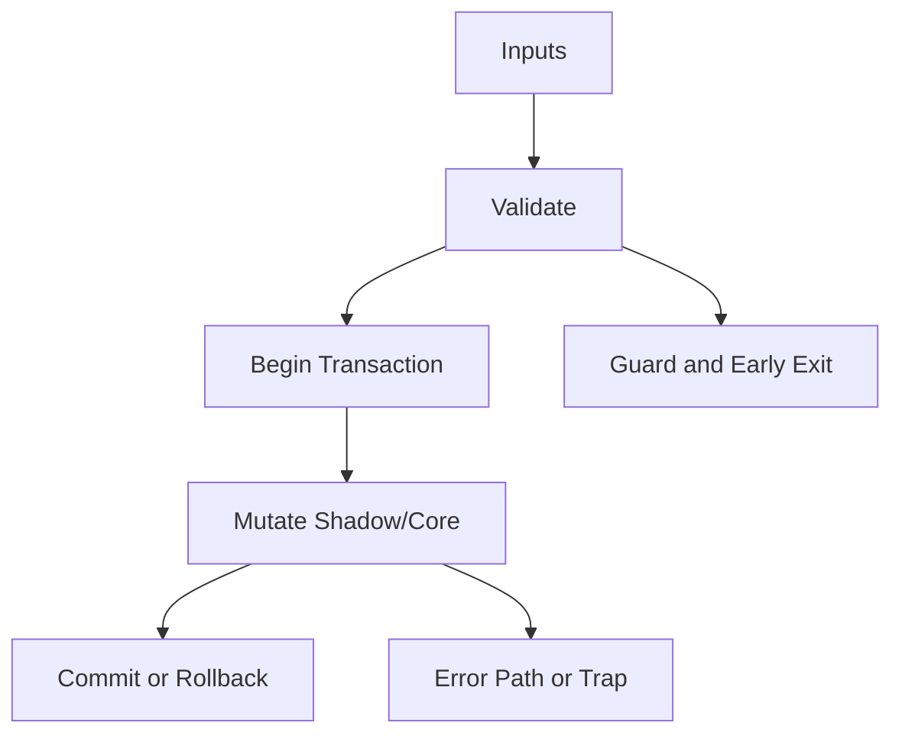

/*
 * Copyright (c) 2026 TataG Systems. All rights reserved.
 *
 * Project:    DGTL (Deep General-purpose Transformation Layer)
 * Owner:      Divyanshu Tata
 * Repository: github.com/TataG-Systems/DGTL
 *
 * This software is the proprietary property of TataG Systems.
 * Unauthorized copying, modification, or distribution is strictly prohibited.
 */

# MultiArch_Orchestrator.hpp

Source Header: include/dgtl/jit/orchestrator/MultiArch_Orchestrator.hpp
Last Synced: 2026-04-20

## Vision
Multi-target AOT compilation dispatch hub. Routes binary output requests to the correct backend emitter based on file extension or target specification. Supports 9 output formats.

## Why This File Exists
- Route `.wasm` to DGTLWasmEncoder, `.o` to ELF relocatable, `.a` to GNU ar archive, `.obj` to COFF relocatable, `.lib` to COFF archive, `.macho` to MachOEmitter.
- Keep responsibilities localized so surrounding passes and backends can compose without hidden coupling.
- Preserve correctness with explicit guardrails before optimization gains.
- Runtime orchestration is partitioned to separate policy selection from execution mechanics.
- Sentinel-style integrity checks are intentionally present to detect corruption before commit stages.

## Core Logic
- Inputs are validated early and non-actionable states return fast.
- Main logic operates on typed IR structures and explicit state transitions.
- Transactional semantics are present: begin, mutate, validate, then commit or rollback.
- Defensive error paths are explicit to prevent silent corruption propagation.

## Control Flow Graph and Map

## Control Flow Narrative
- Entry points validate stream and state before any mutation or expensive work.
- Mutation paths are transactional to ensure safe rollback on validation failure.
- Failure branches escalate with explicit errors or traps when invariants are violated.

## Include Dependencies
- #include <memory>
- #include <string_view>
- #include <chrono>
- #include <stdexcept>
- #include <string>
- #include "dgtl/core/Target.hpp"
- #include "dgtl/ir/base/Global_IR.hpp"

## Class and Struct Catalog
### Classes
- class DGTLLinker;
- class DGTLMachOEmitter;
- class DGTLWasmEncoder;
- class DGTLOrchestrator {
### Structs
- struct CompilationReport {

## Enum Catalog
- none detected

## Function Catalog
- void compile_to_binary(std::string_view output_path, const ir::IRStream& stream) { — Extension-based dispatch (.wasm/.o/.a/.obj/.lib/.macho)
- const std::string out_path(output_path);
- else if (out_path.size() >= 2 && out_path.substr(out_path.size() - 2) == ".o") {
- [[nodiscard]] CompilationReport get_last_report() const noexcept {
- void dispatch_to_linker(std::string_view path, const ir::IRStream& stream); — ELF .o and .a
- void dispatch_to_macho(std::string_view path, const ir::IRStream& stream); — Mach-O ARM64
- void dispatch_to_wasm(std::string_view path, const ir::IRStream& stream); — WebAssembly
- void dispatch_to_coff_relocatable(std::string_view path, const ir::IRStream& stream); — COFF .obj
- void dispatch_to_coff_archive(std::string_view path, const ir::IRStream& stream); — COFF .lib

## Design Decisions and Whys
- Explicit typing across IR nodes and flags reduces hidden semantic drift.
- Guard checks prevent invalid states from propagating into emitters and runtime paths.
- Layered modules allow policy evolution in pass and pipeline without backend rewrites.

## Critical Invariants
- Shadow integrity must validate before state is committed.
- Null or invalid sentinel states must be short-circuited early.
- Error paths must fail loudly to avoid silent semantic drift.

## Practical Reading Order
- Start with type and enum declarations.
- Follow entry functions for control-flow intent.
- Then inspect helper methods for safety and transformation details.
