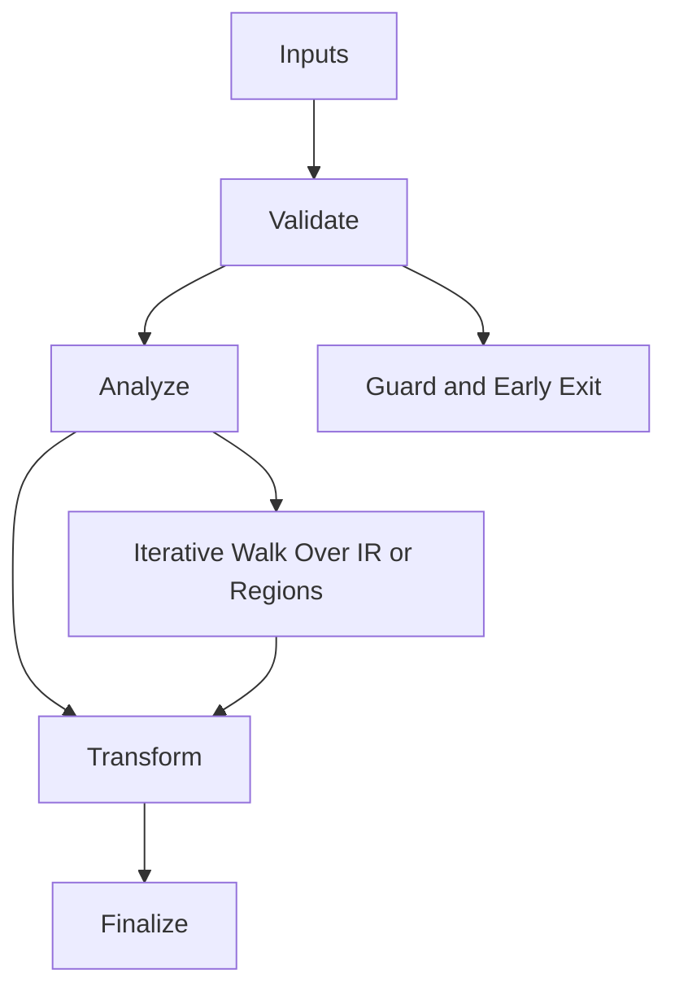

/*
 * Copyright (c) 2026 TataG Systems. All rights reserved.
 *
 * Project:    DGTL (Deep General-purpose Transformation Layer)
 * Owner:      Divyanshu Tata
 * Repository: github.com/TataG-Systems/DGTL
 *
 * This software is the proprietary property of TataG Systems.
 * Unauthorized copying, modification, or distribution is strictly prohibited.
 */

# Strike_Orchestrator.hpp

Source Header: include/dgtl/jit/orchestrator/Strike_Orchestrator.hpp
Last Synced: 2026-04-20

## Vision
The "Command Center" for x64 JIT execution. Orchestrates the 4-stage Fire Strike: Optimization → Emission → Injection → Execution, with closed-loop AI cost model feedback. Exposed to the production CLI via `--jit-execute`.

## Why This File Exists
- Provide a single `fire_strike()` entry point that compiles IR to x64 machine code and executes it in-process.
- Chain StackPiller → X64StrikeEmitter → StrikeRunner (W^X inject + execute) → DGTLJitExecutor (feedback collection) → DGTLAICostModel (learning).
- Pre-allocates 16MB scratch buffer for zero mid-strike heap allocation.
- Keep responsibilities localized so surrounding passes and backends can compose without hidden coupling.

## Core Logic
- Inputs are validated early and non-actionable states return fast.
- Main logic operates on typed IR structures and explicit state transitions.
- Traversal is iterative to keep performance linear over stream and region size.
- The design favors deterministic transformations and bounded side effects.

## Control Flow Graph and Map

## Control Flow Narrative
- Entry points validate stream and state before any mutation or expensive work.
- Processing is mainly loop-driven to walk nodes, regions, or dependency structures.

## Include Dependencies
- #include <vector>
- #include <cstdint>
- #include "dgtl/core/Context.hpp"
- #include "dgtl/ir/base/Global_IR.hpp"
- #include "dgtl/isa/lowering/Stack_Spiller.hpp"
- #include "dgtl/isa/emitter/X64_Strike_Emitter.hpp"
- #include "dgtl/jit/orchestrator/Strike_Runner.hpp"
- #include "dgtl/analysis/cost/AI_Cost_Model.hpp"
- #include "dgtl/jit/runtime/JIT_Executor.hpp"

## Class and Struct Catalog
### Classes
- class StrikeOrchestrator {

## Enum Catalog
- none detected

## Function Catalog
- dgtl::exec::StrikeMetrics fire_strike(ir::IRStream& stream, void* data_payload = nullptr) { — 4-stage pipeline: emit x64 → inject (VirtualAlloc + W^X) → execute → AI cost feedback loop
- void hard_reset() { — Recycles arena + shrinks scratch buffer if >32MB
- [[nodiscard]] size_t get_last_code_size() const noexcept { — Returns size of last emitted machine code
- [[nodiscard]] uint32_t get_stack_frame_requirement() const noexcept { — Reserved for StackPiller frame size

## Constants
- STRIKE_OK = 0x0 — Successful execution
- STRIKE_INVALID_STREAM = 0xE001 — Null or empty IR stream
- STRIKE_EMIT_EMPTY = 0xE002 — Emitter produced no machine code
- STRIKE_INJECT_FAILED = StrikeStatus::InjectFailed — VirtualAlloc/mmap failure

## CLI Integration
- Production driver: `--backend x64 --jit-execute`
- Requires `DGTL_STRIKE_EXECUTE=1` environment variable (security gate)
- Output: `[DGTL-JIT] Strike OK status=0x0 executed_instructions=N code_size=N`

## Design Decisions and Whys
- Explicit typing across IR nodes and flags reduces hidden semantic drift.
- Guard checks prevent invalid states from propagating into emitters and runtime paths.
- Layered modules allow policy evolution in pass and pipeline without backend rewrites.

## Critical Invariants
- Null or invalid sentinel states must be short-circuited early.

## Practical Reading Order
- Start with type and enum declarations.
- Follow entry functions for control-flow intent.
- Then inspect helper methods for safety and transformation details.
