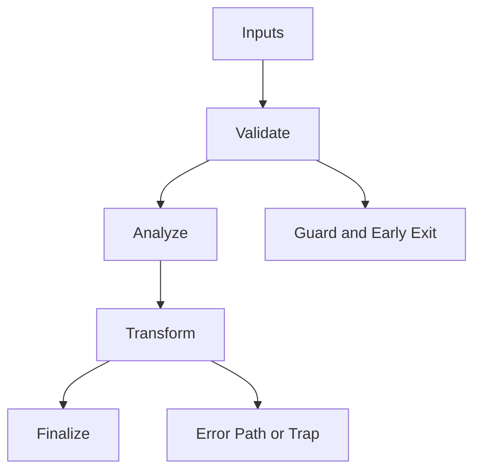

/*
 * Copyright (c) 2026 TataG Systems. All rights reserved.
 *
 * Project:    DGTL (Deep General-purpose Transformation Layer)
 * Owner:      Divyanshu Tata
 * Repository: github.com/TataG-Systems/DGTL
 *
 * This software is the proprietary property of TataG Systems.
 * Unauthorized copying, modification, or distribution is strictly prohibited.
 */

# _Executor.hpp

Source Header: include/dgtl//runtime/_Executor.hpp
Last Synced: 2026-04-14 19:46:41

## Vision
This component exists to make the compiler/runtime pipeline explicit, safe, and predictable under high-performance constraints.

## Why This File Exists
- Drive runtime execution, specialization, and backend dispatch with predictable safety checks.
- Keep responsibilities localized so surrounding passes and backends can compose without hidden coupling.
- Preserve correctness with explicit guardrails before optimization gains.
- Runtime orchestration is partitioned to separate policy selection from execution mechanics.

## Core Logic
- Inputs are validated early and non-actionable states return fast.
- Main logic operates on typed IR structures and explicit state transitions.
- The design favors deterministic transformations and bounded side effects.
- Defensive error paths are explicit to prevent silent corruption propagation.

## Control Flow Graph and Map

## Control Flow Narrative
- Entry points validate stream and state before any mutation or expensive work.
- Failure branches escalate with explicit errors or traps when invariants are violated.

## Include Dependencies
- #include <vector>
- #include <algorithm>
- #include <chrono>
- #include <cstring>
- #include <cstdint>
- #include 
- #include <unordered_map>
- #include <stdexcept>
- #include <memory>
- #include <mutex>
- #include <iostream>
- #include "dgtl/ir/base/Global_IR.hpp"
- #include "dgtl/analysis/cost/AI_Cost_Model.hpp"
- #include <windows.h>
- #include <sys/mman.h>
- #include <unistd.h>
- #include <sys/types.h>

## Class and Struct Catalog
### Classes
- class alignas(64) DGTLExecutor {
### Structs
- struct TraceMeta {

## Enum Catalog
- none detected

## Function Catalog
- Function load_and_prepare(std::span<const uint8_t> binary, const dgtl::ir::IRStream& source_ir) {
- std::lock_guard<std::mutex> lock(_mtx);
- dgtl::ir::IRStream get_ir_from_address(uint64_t address) {
- dgtl::analysis::RuntimeFeedback collect_feedback(uintptr_t function_id) {
- void sync_caches(void* ptr, size_t size) noexcept {
- void finalize_page_protection(void* ptr, size_t size) {

## Design Decisions and Whys
- Explicit typing across IR nodes and flags reduces hidden semantic drift.
- Guard checks prevent invalid states from propagating into emitters and runtime paths.
- Layered modules allow policy evolution in pass and pipeline without backend rewrites.

## Critical Invariants
- Error paths must fail loudly to avoid silent semantic drift.

## Practical Reading Order
- Start with type and enum declarations.
- Follow entry functions for control-flow intent.
- Then inspect helper methods for safety and transformation details.
