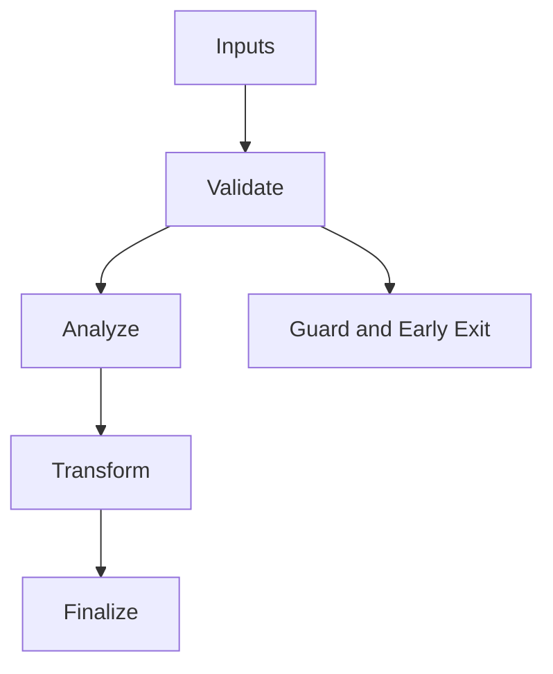

/*
 * Copyright (c) 2026 TataG Systems. All rights reserved.
 *
 * Project:    DGTL (Deep General-purpose Transformation Layer)
 * Owner:      Divyanshu Tata
 * Repository: github.com/TataG-Systems/DGTL
 *
 * This software is the proprietary property of TataG Systems.
 * Unauthorized copying, modification, or distribution is strictly prohibited.
 */

# Tiered_Controller.hpp

Source Header: include/dgtl/jit/runtime/Tiered_Controller.hpp
Last Synced: 2026-04-14 19:46:41

## Vision
This component exists to make the compiler/runtime pipeline explicit, safe, and predictable under high-performance constraints.

## Why This File Exists
- Drive runtime execution, specialization, and backend dispatch with predictable safety checks.
- Keep responsibilities localized so surrounding passes and backends can compose without hidden coupling.
- Preserve correctness with explicit guardrails before optimization gains.
- Runtime orchestration is partitioned to separate policy selection from execution mechanics.

## Core Logic
- Inputs are validated early and non-actionable states return fast.
- Main logic operates on typed IR structures and explicit state transitions.
- The design favors deterministic transformations and bounded side effects.

## Control Flow Graph and Map

## Control Flow Narrative
- Entry points validate stream and state before any mutation or expensive work.

## Include Dependencies
- #include <filesystem>
- #include <fstream>
- #include "JIT_Executor.hpp"
- #include "dgtl/isa/emitter/NASM_Emitter.hpp"
- #include "dgtl/jit/speculation/Async_Speculator.hpp"

## Class and Struct Catalog
### Classes
- class TieredController {

## Enum Catalog
- none detected

## Function Catalog
- void profile_and_check(dgtl::isa::JitFunction func_ptr, const core::DGTLSymbolTable& symbols) {
- void select_best_version(std::vector<SpeculativeVersion>& versions) {
- void bake_to_disk(uintptr_t addr, const core::DGTLSymbolTable& symbols) {
- std::ofstream file(filename);

## Design Decisions and Whys
- Explicit typing across IR nodes and flags reduces hidden semantic drift.
- Guard checks prevent invalid states from propagating into emitters and runtime paths.
- Layered modules allow policy evolution in pass and pipeline without backend rewrites.

## Critical Invariants
- Null or invalid sentinel states must be short-circuited early.

## Practical Reading Order
- Start with type and enum declarations.
- Follow entry functions for control-flow intent.
- Then inspect helper methods for safety and transformation details.
