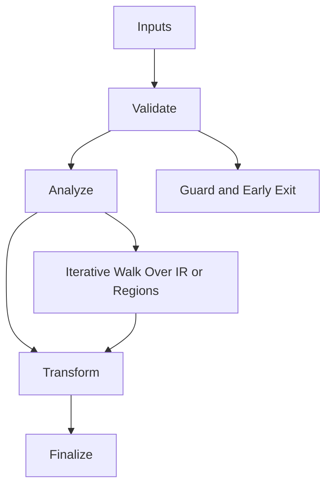

/*
 * Copyright (c) 2026 TataG Systems. All rights reserved.
 *
 * Project:    DGTL (Deep General-purpose Transformation Layer)
 * Owner:      Divyanshu Tata
 * Repository: github.com/TataG-Systems/DGTL
 *
 * This software is the proprietary property of TataG Systems.
 * Unauthorized copying, modification, or distribution is strictly prohibited.
 */

# Async_Speculator.hpp

Source Header: include/dgtl/jit/speculation/Async_Speculator.hpp
Last Synced: 2026-04-14 19:46:41

## Vision
This component exists to make the compiler/runtime pipeline explicit, safe, and predictable under high-performance constraints.

## Why This File Exists
- Drive runtime execution, specialization, and backend dispatch with predictable safety checks.
- Keep responsibilities localized so surrounding passes and backends can compose without hidden coupling.
- Preserve correctness with explicit guardrails before optimization gains.
- Sentinel-style integrity checks are intentionally present to detect corruption before commit stages.

## Core Logic
- Inputs are validated early and non-actionable states return fast.
- Main logic operates on typed IR structures and explicit state transitions.
- Traversal is iterative to keep performance linear over stream and region size.
- Structural hashes are refreshed or verified to preserve correctness across rewrites.
- The design favors deterministic transformations and bounded side effects.
- Defensive error paths are explicit to prevent silent corruption propagation.

## Control Flow Graph and Map

## Control Flow Narrative
- Entry points validate stream and state before any mutation or expensive work.
- Processing is mainly loop-driven to walk nodes, regions, or dependency structures.

## Include Dependencies
- #include <atomic>
- #include <thread>
- #include <vector>
- #include <queue>
- #include <mutex>
- #include <condition_variable>
- #include <unordered_map>
- #include "dgtl/ir/base/Global_IR.hpp"
- #include "dgtl/jit/runtime/JIT_Executor.hpp"

## Class and Struct Catalog
### Classes
- class alignas(64) AsyncSpeculator {
### Structs
- struct SpeculativeVersion {
- struct SpeculativeCache {

## Enum Catalog
- none detected

## Function Catalog
- std::lock_guard<std::mutex> lock(m_registry_mtx);
- void speculate_branch(const ir::IRStream& stream, uint32_t target_node_idx) {
- std::lock_guard<std::mutex> lock(m_queue_mtx);
- dgtl::exec::JitFunction get_speculative_target(uint32_t node_idx) {
- std::vector<SpeculativeVersion> generate_versions(ir::IRNode* node);
- void worker_loop() {
- std::unique_lock<std::mutex> lock(m_queue_mtx);
- bool perform_speculative_strike(ir::IRStream& stream, uint32_t start_idx) {
- ir::IRTransactionGuard tx(stream);
- bool validate_ir_invariants(const ir::IRStream& stream) {
- std::vector<uint8_t> emit_speculative_code(const ir::IRStream& stream) {

## Design Decisions and Whys
- Explicit typing across IR nodes and flags reduces hidden semantic drift.
- Guard checks prevent invalid states from propagating into emitters and runtime paths.
- Layered modules allow policy evolution in pass and pipeline without backend rewrites.

## Critical Invariants
- Intent hash values must be consistent with opcode and operands after mutation.
- Null or invalid sentinel states must be short-circuited early.

## Practical Reading Order
- Start with type and enum declarations.
- Follow entry functions for control-flow intent.
- Then inspect helper methods for safety and transformation details.
