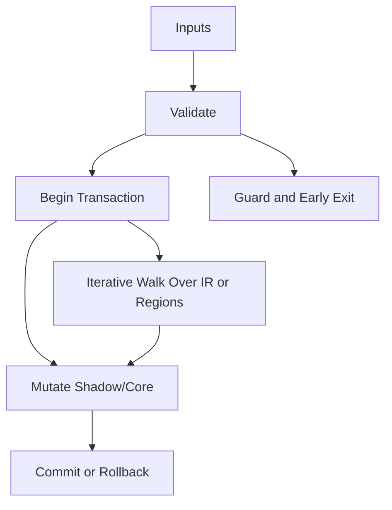

/*
 * Copyright (c) 2026 TataG Systems. All rights reserved.
 *
 * Project:    DGTL (Deep General-purpose Transformation Layer)
 * Owner:      Divyanshu Tata
 * Repository: github.com/TataG-Systems/DGTL
 *
 * This software is the proprietary property of TataG Systems.
 * Unauthorized copying, modification, or distribution is strictly prohibited.
 */

# Instruction_Reordering.hpp

Source Header: include/dgtl/pass/transform/Instruction_Reordering.hpp
Last Synced: 2026-04-14 19:46:42

## Vision
This component exists to make the compiler/runtime pipeline explicit, safe, and predictable under high-performance constraints.

## Why This File Exists
- Apply correctness-preserving transformations to improve cost, latency, and code quality.
- Keep responsibilities localized so surrounding passes and backends can compose without hidden coupling.
- Preserve correctness with explicit guardrails before optimization gains.
- Transformation safety is bounded here through checks that preserve IR validity and intent.
- Sentinel-style integrity checks are intentionally present to detect corruption before commit stages.

## Core Logic
- Inputs are validated early and non-actionable states return fast.
- Main logic operates on typed IR structures and explicit state transitions.
- Traversal is iterative to keep performance linear over stream and region size.
- Structural hashes are refreshed or verified to preserve correctness across rewrites.
- Transactional semantics are present: begin, mutate, validate, then commit or rollback.
- Defensive error paths are explicit to prevent silent corruption propagation.

## Control Flow Graph and Map

## Control Flow Narrative
- Entry points validate stream and state before any mutation or expensive work.
- Processing is mainly loop-driven to walk nodes, regions, or dependency structures.
- Mutation paths are transactional to ensure safe rollback on validation failure.

## Include Dependencies
- #include <vector>
- #include <algorithm>
- #include <cstdint>
- #include <memory>
- #include "dgtl/ir/base/Global_IR.hpp"
- #include "dgtl/analysis/dataflow/Memory_Dependency_Smasher.hpp"
- #include "dgtl/analysis/cost/AI_Cost_Model.hpp"
- #include "dgtl/core/Verified_Formal.hpp"
- #include "dgtl/pipeline/Pass_Manager.hpp"

## Class and Struct Catalog
### Classes
- class Instruction_Reordering_Pass : public pipeline::DGTLOptimizationPass {
### Structs
- struct IR_Op {

## Enum Catalog
- none detected

## Function Catalog
- void execute(ir::IRStream& stream) override {
- [[nodiscard]] const char* get_pass_name() const noexcept override {
- [[nodiscard]] pipeline::PassStage get_stage() const noexcept override {
- [[nodiscard]] pipeline::PassAffinity hot_path_affinity() const noexcept override {
- [[nodiscard]] pipeline::PassAffinity memory_affinity() const noexcept override {
- [[nodiscard]] pipeline::PassAffinity vector_affinity() const noexcept override {
- [[nodiscard]] pipeline::PassAffinity speculation_affinity() const noexcept override {
- void run_optimization(std::vector<IR_Op>& block, const ir::IRStream& stream) {
- bool should_swap(const IR_Op& A, const IR_Op& B, const ir::IRStream& stream) {
- float get_instruction_cost(const IR_Op& op, const ir::IRStream& stream) {
- void apply_to_shadow(ir::IRStream& s, uint32_t shadow_idx, const ir::IRNode& node) {

## Design Decisions and Whys
- Explicit typing across IR nodes and flags reduces hidden semantic drift.
- Guard checks prevent invalid states from propagating into emitters and runtime paths.
- Layered modules allow policy evolution in pass and pipeline without backend rewrites.

## Critical Invariants
- Shadow integrity must validate before state is committed.
- Transaction boundaries must remain balanced across success and failure paths.
- Intent hash values must be consistent with opcode and operands after mutation.
- Null or invalid sentinel states must be short-circuited early.

## Practical Reading Order
- Start with type and enum declarations.
- Follow entry functions for control-flow intent.
- Then inspect helper methods for safety and transformation details.
