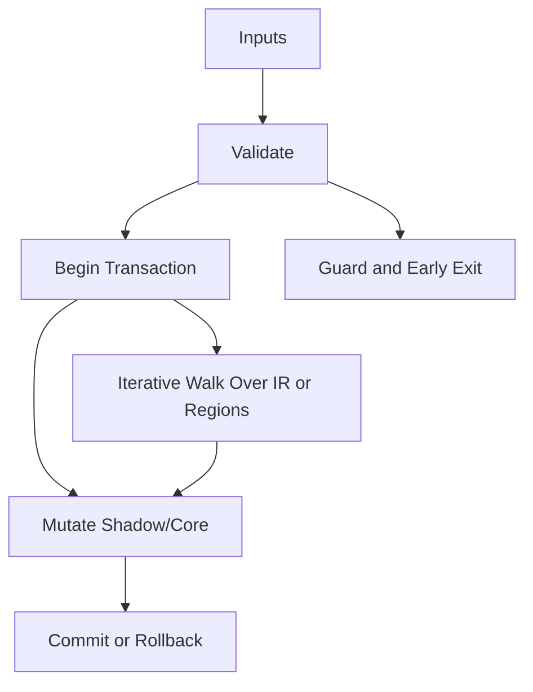

/*
 * Copyright (c) 2026 TataG Systems. All rights reserved.
 *
 * Project:    DGTL (Deep General-purpose Transformation Layer)
 * Owner:      Divyanshu Tata
 * Repository: github.com/TataG-Systems/DGTL
 *
 * This software is the proprietary property of TataG Systems.
 * Unauthorized copying, modification, or distribution is strictly prohibited.
 */

# Auto_Tuner.hpp

Source Header: include/dgtl/pass/tuning/Auto_Tuner.hpp
Last Synced: 2026-04-14 19:46:42

## Vision
This component exists to make the compiler/runtime pipeline explicit, safe, and predictable under high-performance constraints.

## Why This File Exists
- Apply correctness-preserving transformations to improve cost, latency, and code quality.
- Keep responsibilities localized so surrounding passes and backends can compose without hidden coupling.
- Preserve correctness with explicit guardrails before optimization gains.
- Sentinel-style integrity checks are intentionally present to detect corruption before commit stages.

## Core Logic
- Inputs are validated early and non-actionable states return fast.
- Main logic operates on typed IR structures and explicit state transitions.
- Traversal is iterative to keep performance linear over stream and region size.
- Structural hashes are refreshed or verified to preserve correctness across rewrites.
- Transactional semantics are present: begin, mutate, validate, then commit or rollback.

## Control Flow Graph and Map

## Control Flow Narrative
- Entry points validate stream and state before any mutation or expensive work.
- Processing is mainly loop-driven to walk nodes, regions, or dependency structures.
- Mutation paths are transactional to ensure safe rollback on validation failure.

## Include Dependencies
- #include <chrono>
- #include <vector>
- #include <cstdint>
- #include <memory>
- #include <cstring>
- #include "dgtl/ir/base/Global_IR.hpp"
- #include "dgtl/jit/runtime/JIT_Executor.hpp"
- #include "dgtl/core/Verified_Formal.hpp"

## Class and Struct Catalog
### Classes
- class DGTLAutoTuner {
### Structs
- struct TuningResult {

## Enum Catalog
- none detected

## Function Catalog
- TuningResult tune_loop_nest(const ir::IRStream& base_stream) {
- static inline uint64_t read_hardware_counter_start() noexcept {
- __asm__ __volatile__ ("cpuid\n\t" "rdtsc\n\t" : "=a"(lo), "=d"(hi) : "a"(0) : "%ebx", "%ecx");
- __asm__ __volatile__("isb\n\t" "mrs %0, cntvct_el0" : "=r"(val));
- static inline uint64_t read_hardware_counter_end() noexcept {
- __asm__ __volatile__("mrs %0, cntvct_el0\n\t" "isb" : "=r"(val));
- ir::IRStream clone_and_unroll_transactional(const ir::IRStream& src, uint32_t factor) {
- static uint64_t estimate_cycles_fallback(const ir::IRStream& stream, uint32_t factor) noexcept {

## Design Decisions and Whys
- Explicit typing across IR nodes and flags reduces hidden semantic drift.
- Guard checks prevent invalid states from propagating into emitters and runtime paths.
- Layered modules allow policy evolution in pass and pipeline without backend rewrites.

## Critical Invariants
- Shadow integrity must validate before state is committed.
- Intent hash values must be consistent with opcode and operands after mutation.
- Null or invalid sentinel states must be short-circuited early.

## Practical Reading Order
- Start with type and enum declarations.
- Follow entry functions for control-flow intent.
- Then inspect helper methods for safety and transformation details.
