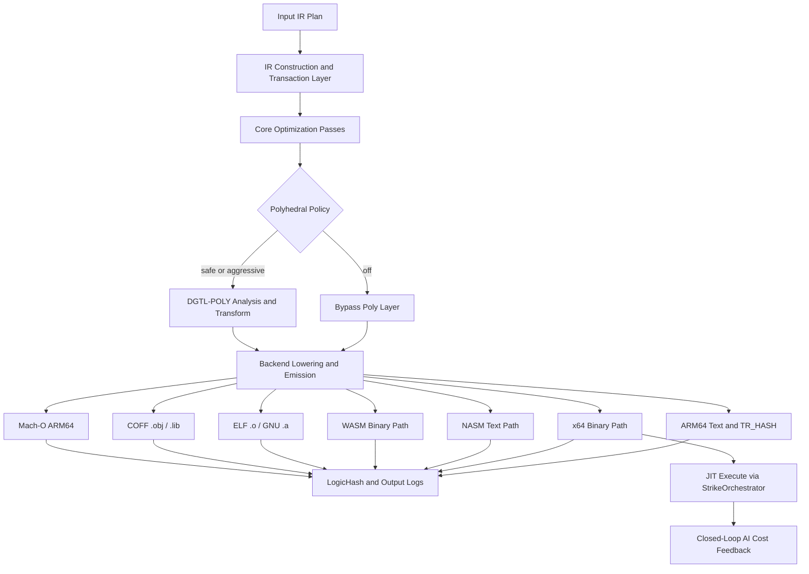

/*
 * Copyright (c) 2026 TataG Systems. All rights reserved.
 *
 * Project:    DGTL (Deep General-purpose Transformation Layer)
 * Owner:      Divyanshu Tata
 * Repository: github.com/TataG-Systems/DGTL
 *
 * This software is the proprietary property of TataG Systems.
 * Unauthorized copying, modification, or distribution is strictly prohibited.
 */

# DGTL Theory Of Operation

## Scope

This document describes the observable DGTL compilation pipeline for proprietary/public-facing technical review.

## Design Goals

- deterministic lowering behavior per backend
- traceable transformation output via logic hash and instruction trace markers
- multi-backend parity for the `int` IR mode
- controlled disclosure without exposing proprietary implementation internals

## Observable Pipeline

1. Frontend/IR construction produces a transactional IR stream.
2. Core optimization and legality checks run on IR.
3. Optional polyhedral stage is applied based on runtime flag policy.
4. Backend lowering emits backend-specific representation.
5. Emission includes traceability artifacts (`LogicHash`, `TR_HASH` lines where applicable).

## Backend Roles

### Assembly & Binary Backends
- `arm64`: text assembly with explicit trace markers.
- `x64`: compact binary emission (with conformance and benchmark gate).
- `nasm`: textual x86-family emission path for assembler workflows.
- `wasm`: WebAssembly-targeted binary emission path.

### Native Object & Library Backends
- `elfobj`: ELF64 relocatable object (`.o`) with section header table, `.text`, `.symtab`, `.strtab`, `.shstrtab`, and `.rela.text` sections. Compatible with `ld`, `gcc`, `clang`.
- `staticlib`: GNU `ar` static archive (`.a`) wrapping DGTL-generated ELF objects.
- `coffobj`: COFF relocatable object (`.obj`) with `IMAGE_FILE_MACHINE_AMD64`. Compatible with MSVC `link.exe` and MinGW `ld`.
- `cofflib`: COFF archive (`.lib`) with first linker member (big-endian symbol index) and embedded COFF member. Compatible with MSVC `link.exe`.
- `macho`: Mach-O 64-bit ARM64 object file with `LC_SEGMENT_64` + `LC_SYMTAB` load commands and real ARM64 binary instruction encoding.

### JIT Execution Backend
- `--jit-execute` (x64 only): Invokes `StrikeOrchestrator::fire_strike()` for in-process compile → inject → execute with closed-loop AI cost model feedback via `DGTLJitExecutor::collect_feedback()`.

## Polyhedral Position

Current production defaults:

- `--polyhedral-mode off`
- `--polyhedral-parallel auto`
- `--polyhedral-tile 0`

When disabled, pipeline logs include `[DGTL-POLY] Polyhedral analysis disabled`.

## Architecture Diagram

## Traceability Signals

- `LogicHash`: end-to-end lowering integrity marker for a given IR workload.
- `TR_HASH`: per-instruction trace marker in applicable text emission outputs.

## Publication Guidance (Proprietary)

Share publicly:

- architecture flow
- output examples
- benchmark methodology and logs

Do not publish:

- proprietary pass source code
- internal heuristic constants and private implementation details
